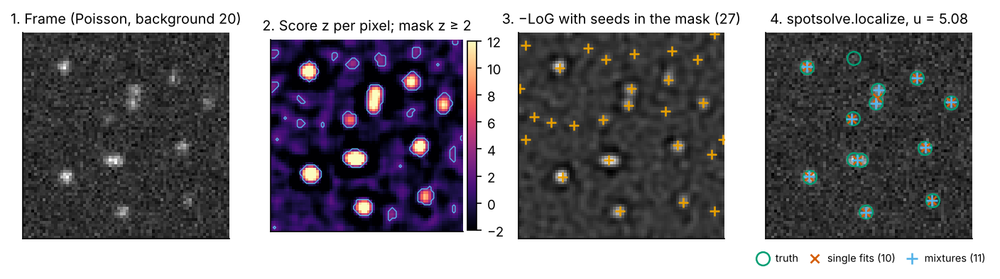
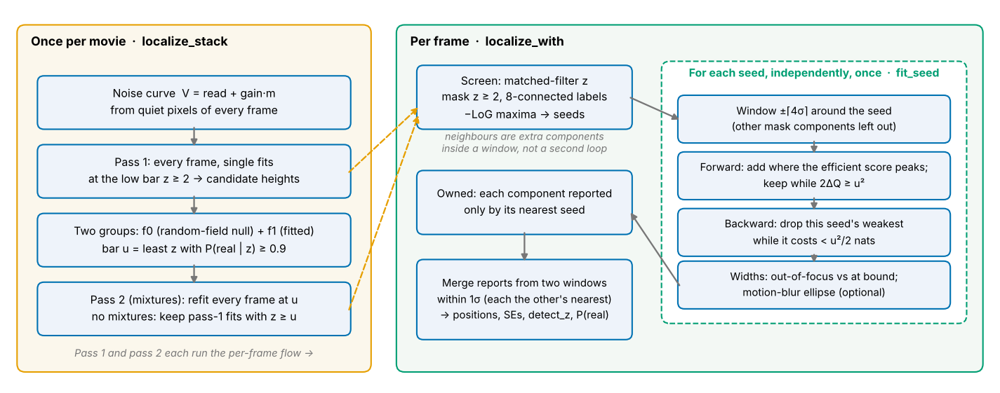
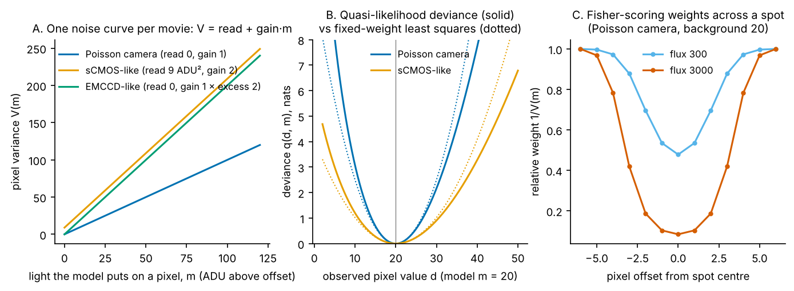
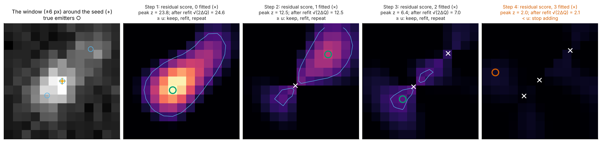
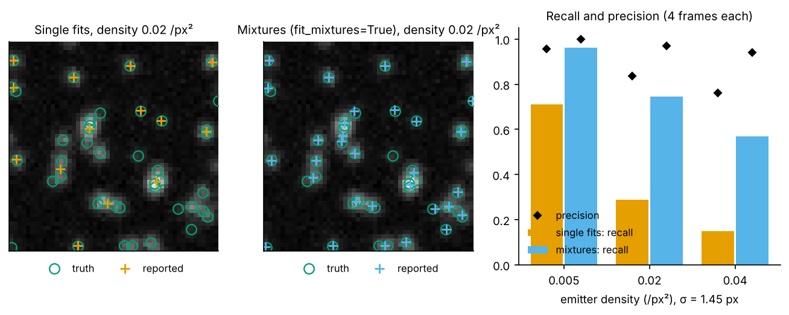
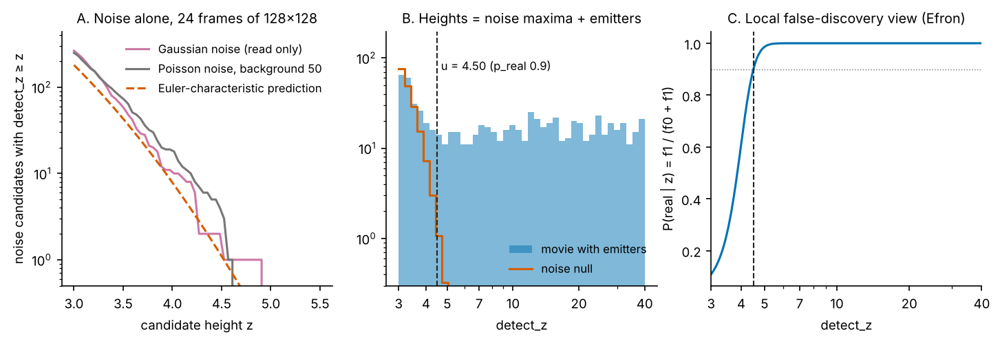

# 01 · Finding and fitting spots

*spotsolve 0.6.0. Source: `rust/spotsolve-core/src/{prefilter,detect,fit,posterior,ellipse,psf}.rs`. Entry points: `spotsolve.localize` (one frame), `localize_stack` (a movie), `estimate_gain`.*

The detector's job sounds simple: find every fluorophore in a frame and say where it is, with an error bar. Three things make that hard in practice. Spots sit on a background that varies across the cell. Noise grows with the light, so bright pixels are noisier than dark ones. And in a crowded frame, spots overlap. spotsolve deals with each in turn:

1. It models how noisy a pixel is at each level of light, a **noise curve**, and fits by the likelihood that curve implies rather than by least squares.
2. It finds *where to look* with a cheap matched filter, the idea behind DAOPHOT's FIND.
3. It fits every source of light in a window together, adding components where the data ask for one and removing those that do not pay.
4. It decides which fits are real with a **bar** set per movie: the height above which an emitter is real with 90% probability, given how many maxima pure noise would produce.

*Figure 1.1. One simulated 72×72 frame (σ = 1.45 px, background 20 photons, 13 emitters). Left to right: the data; the screen score z (step 2) with the candidate mask z ≥ 2; LoG seeds inside the mask; single-emitter fits; mixture fits. Single fits recover 10 of the 13 emitters and mixtures 11. The bar for this movie is u = 5.08. (Screen and seeds are re-implemented in numpy for display; the fits are `spotsolve.localize`.)*

### The flow, end to end

`localize_stack` makes three passes over the movie. The first two set the noise curve and the bar; only the last one produces the reported emitters (`detect::localize_stack_observed`, `localize_with`, `fit_seed`).

*Figure 1.0. Left: the passes over the whole movie, which set the noise curve and the bar u. Right: what each pass does to one frame. Each seed's window is fitted once (`fit_seed`), and overlaps between windows are settled by ownership and merging.*

Each seed's window is fitted **once**. Neighbouring emitters are handled *inside* that window as extra components, which act as nuisance parameters, rather than by grouping seeds and iterating. The search of the residual for emitters the screen missed, which DAOPHOT and DAOSTORM do over the whole frame, happens inside each window's forward step (§5, figure 1.3). Windows overlap, so the same emitter can be fitted by two seeds. Ownership (each component is reported only by its nearest seed) and merging (two near-identical reports become one) settle that afterwards. With single fits, the forward step adds exactly one component, held within 2σ of its seed, and there is no backward step.

---

## 1. The image model

A spot is a Gaussian PSF of width s, integrated over each square pixel. Along one axis the light in pixel i from an emitter at c is

$$
E_i(c, s) = \tfrac12\left[\operatorname{erf}\!\left(\frac{i + \tfrac12 - c}{\sqrt2\, s}\right) - \operatorname{erf}\!\left(\frac{i - \tfrac12 - c}{\sqrt2\, s}\right)\right],
$$

and a window holds a constant level b plus K components:

$$
m_{yx} = b + \sum_{k=1}^{K} A_k\, E_y(y_k, s_k)\, E_x(x_k, s_k).
$$

This is `psf::add_emitter` and `psf::model`. Each component carries its own width s_k (layout `Layout { sigma: None }`), bounded to `WIDTH` = (1, 1.5)·σ, where σ is the nominal PSF width. 1.5σ is roughly where defocus has halved the peak. The window around a seed has half-side R = ⌈4σ⌉ (`WINDOW`).

## 2. The noise curve and the quasi-likelihood

For a camera counting photo-electrons with gain g (ADU per photon) and Gaussian read noise r (ADU²), a pixel of mean m has variance

$$
V(m) = r + g\,m,
$$

held above a floor (`prefilter::Curve::at`). Fitting by least squares treats every pixel as equally noisy, which over-weights a spot's bright centre. The right weight is 1/V(m), and m is what we are fitting, so the weight moves with the fit.

spotsolve uses Wedderburn's **quasi-likelihood** for this variance function (`Curve::deviance`):

$$
q(d, m) = \int_m^d \frac{d - t}{V(t)}\, dt ,\qquad Q(\theta) = \sum_{\text{pixels}} q(d_i, m_i(\theta)).
$$

Two facts make this the natural choice:

- **Its gradient is the weighted residual.** ∂q/∂m = (m − d)/V(m). Minimising Q is therefore iteratively reweighted least squares, with each pixel weighted by its own noise at the current model.
- **For a linear V, it is a shifted Poisson deviance.** With τ = r/g, q(d, m) equals the Poisson deviance (halved) of d + τ at m + τ, divided by g. This is the same "add the read variance as extra Poisson counts" approximation Huang et al. (2013) introduced for sCMOS cameras. It keeps the skew of shot noise, which a Gaussian likelihood loses.

Every decision below (keep a component, add one, merge two) compares values of Q. A likelihood-ratio statistic 2ΔQ is approximately χ²₁ under the null, so √(2ΔQ) behaves like a z-score.

**Measuring the curve.** The read variance r and the gain g are set per movie:

- **Read variance** comes from the separable fourth difference [1, −4, 6, −4, 1]. It cancels any smooth background, and on pure noise its output has variance 70²·V. Taking the median over 32-px tiles of quiet pixels and scaling by the χ²₁ median (`CHI2_1_MEDIAN`) gives a level-by-level variance that ignores spots (`prefilter::dispersion`, `noise_points`, `read_given`).
- **Gain** is measured by `estimate_gain`. It fits bright isolated spots (z ≥ `PROBE` = 8, where shot noise dominates), divides each pixel's leverage-corrected squared residual by the curve's variance, and solves for the gain at which the median of those ratios is the χ²₁ median. It collects 128–10,000 pixels (`PROBE_PIXELS`, `PROBE_ROWS`).

*Figure 1.2. A: the noise curve V = r + g·m for three kinds of camera. B: the quasi-likelihood deviance q(d, m) of one pixel with model value m = 20 (solid) against fixed-weight least squares (dotted). The deviance is asymmetric, as shot noise is. C: the Fisher-scoring weights 1/V(m) across a spot at two fluxes. Least squares would weight every pixel equally; the quasi-likelihood down-weights the bright centre in proportion to its shot noise.*

## 3. Where to look: the screen (DAOPHOT's idea)

Fitting every pixel would be wasteful, so a cheap filter proposes where spots might be (`prefilter::screen`). At each pixel, regress the surrounding window on one PSF g and a constant:

$$
A = \frac{\langle g - \bar g,\ d\rangle}{\lVert g - \bar g\rVert^2},\qquad
z = \frac{A\,\lVert g - \bar g\rVert}{\sqrt{V}} .
$$

A is DAOPHOT FIND's "lowered Gaussian" amplitude (Stetson 1987): the least-squares flux of a spot with the local mean removed. z is its score statistic. The one change from FIND is that V comes from the noise curve at the window's level, not from the window's own residual. A neighbouring spot inside the window therefore cannot inflate the noise estimate and hide the spot being tested.

Then:

- **Mask.** Pixels with z ≥ `CANDIDATE` = 2.
- **Seeds.** Local maxima of the negative Laplacian of Gaussian over a (2⌈σ⌉+1)² square, inside the mask.
- **Labels.** The mask's 8-connected components (`prefilter::label`). A seed's fit leaves out pixels that belong to a *different* component, so two separate blobs inside one window do not fight over each other's light.

This is the layout of u-track's `pointSourceDetection` (Aguet et al. 2013), which spotsolve follows explicitly.

## 4. Fitting one window

Each seed gets a window and a fit (`detect::fit_seed`, `fit::Fitter`). The optimiser is a bounded Levenberg–Marquardt method on Q:

- **Gradient and curvature.** The gradient is Jᵀ(m − d)/V and the curvature is JᵀWJ with W = 1/V. That is the Fisher information, so each step is Fisher scoring (Gauss–Newton on the weighted problem).
- **Bounds.** Flux ≥ 0, widths inside `WIDTH`, and the centre held within `CONFINE` = 2 widths of its seed. Bounds are handled with Coleman–Li-style scaling (|gradient| divided by distance to the bound).
- **Stopping.** The fit stops when no single parameter could lower Q by more than `FIT_TOL` = 10⁻³ nats on its own (`fit::coordinate_gain`). That leaves each parameter within about 0.045 standard errors of its optimum.

Standard errors come from the inverse Fisher information at the final fit.

**Keeping a component.** Let Q₀ be the deviance of the window with the component removed (its light refitted by the rest) and Q₁ with it. The component's height is z = √(2(Q₀ − Q₁)), and it is kept when z ≥ u, the movie's bar (§6).

## 5. Crowded windows: mixtures

With `mixtures=True`, the window is fitted with as many components as its light needs, up to `MAX_MIXTURES` = 20 (a bound on work, not a statistical choice).

**Forward step: where to add a component (`detect::propose`).** The question is, at which position would a new component most improve the fit, *given the current components can readjust*? That is a score test with nuisance parameters, Neyman's C(α) or "efficient score". Let U be the score for a new component's flux at position p, I its information, g the score and F the information of the existing parameters, and b their cross-information. The efficient score and its variance are

$$
U^* = U - b^\top F^{-1} g,\qquad I^* = I - b^\top F^{-1} b,\qquad z(p) = U^*/\sqrt{I^*},
$$

(written here in the generic C(α) form; the code carries the same projection in its own sign convention). The component is placed where z(p) peaks, started from the joint Newton step, and refitted. It stays if the refit gains u²/2 nats.

**This is the residual search, done locally.** DAOPHOT (Stetson 1987) and DAOSTORM (Holden, Uphoff & Kapanidis 2011) find peaks, fit them, subtract the fits from the frame, and run the peak finder again on the residual, until no peak is left. spotsolve has no such pass over the whole frame: the seeds come from one screen of the raw frame (§3). The residual search instead happens inside each seed's window. Look at what z(p) is made of:

- U is the matched filter applied to the **residual** d − m, the data minus everything fitted so far, with each pixel weighted by 1/V at the current light. Before anything is fitted, m is just the level, so step 1 is the screen again on this window.
- The term bᵀF⁻¹g, and bᵀF⁻¹b in the variance, correct for the fitted components being free to move. Light left over at the flank of a fitted spot may just mean that spot is slightly off. A plain residual peak finder would put a new emitter there; the efficient score asks how much a new component would help *after* the old ones readjust.

So each forward step is "subtract what is fitted, filter the residual, add a component at its peak, refit everything together". It repeats until the best new component no longer gains the bar. This is DAOSTORM's loop confined to one window, with a score that accounts for the refit.

*Figure 1.3. The forward step on one window (σ = 1.45 px, so ±6 px) holding three emitters: the seed's emitter, one 2.3 px from it, and a third near the corner. Each panel after the first is the efficient-score map z(p) of the residual, with the components fitted so far (×), the proposed position (○) and the contour z = u = 5. Step 1 proposes one component on the blended pair. Step 2 finds the corner emitter in the residual. Step 3 splits the pair: the refit moves the first component onto the seed's emitter and the new one onto its neighbour. At step 4 the residual's best score is 2.0 < u, so adding stops. Removing any of the three would cost 24 nats, above u²/2 = 12.5, so the backward step keeps all three. (Re-implemented in numpy with weighted least squares and a fixed width, because spotsolve does not expose its intermediate steps; `scripts/fig_01_window.py`.)*

**Is skipping the whole-frame pass a gap?** Not in practice with mixtures on. A frame-wide residual pass can only find an emitter that the screen missed *and* that lies outside every seed's window. Inside a window the forward step already searches the residual. An emitter hidden by a bright neighbour is within ⌈4σ⌉ px of that neighbour's seed, so it is inside that window. An emitter more than ⌈4σ⌉ px from every seed has a residual there that is nearly the raw frame, so a second screen would score it as the first did. The screen removes the local mean and takes V from the noise curve, so a bright spot ⌈4σ⌉ px away barely changes it. Two caveats:

- With `mixtures=False` there is no residual search at all. Each seed gets one component, so an emitter without its own LoG maximum is lost. That is most of the gap between the two columns of the table below.
- I have reasoned this through, not measured it. The direct test is to add a frame-wide residual screen after the fits and count what it finds on crowded simulations.

**Backward step.** Once no addition pays, the weakest component is removed while removing it, with the rest refitted, costs less than u²/2 nats.

**Who reports what.** Neighbouring seeds' windows overlap, so one emitter can be fitted in two windows.

- Each component is reported only by the window whose seed is nearest to it (`detect::owned`).
- Two reports from different windows closer than `MERGE` = 1 width, each the other's nearest, are one emitter fitted twice. One copy is dropped (`detect::merge`).
- A component held at a position bound is not reported.

**Out-of-focus light.** A component may widen past the reported range, up to `widest` = ½⌈4σ⌉. If its width exceeds 1.5σ by more than `WIDER` = 2 standard errors, it is treated as out-of-focus light: it is counted but not reported. Otherwise it is an emitter held at the bound and is flagged `FLAG_BOUND`. Without this, a diffuse blob would be tiled with narrow false emitters.

**Motion blur.** With `motion_blur=True`, a close pair is reported as two emitters only if it beats one elongated, rotated Gaussian (`ellipse::fit`) by the same u²/2 bar. A particle moving during the exposure leaves a streak that would otherwise be split in two.

*Figure 1.4. Simulated frames at increasing emitter density (emitters per px²). Mixtures recover far more emitters in crowded frames, at higher precision.*

| Density | Single fits, recall / precision | Mixtures, recall / precision |
|---|---|---|
| 0.005 | 0.71 / 0.96 | 0.96 / 1.00 |
| 0.02 | 0.29 / 0.84 | 0.75 / 0.97 |
| 0.04 | 0.15 / 0.76 | 0.57 / 0.94 |

## 6. The bar: when is a spot real?

Every decision above is "z ≥ u". The question is what u should be. A fixed u = 5 would be too strict in a sparse movie and too loose in a crowded one. spotsolve sets u per movie with **Efron's two-groups model** (`posterior.rs`):

$$
P(\text{real}\mid z) = \frac{f_1(z)}{f_0(z) + f_1(z)} ,
$$

where f₀ is the density of heights that pure noise produces, f₁ that of real emitters, both per pixel. u is the smallest height at which P(real | z) ≥ `p_real` (default 0.9, `Posterior::cut`).

**The null, f₀: maxima of a random field.** On noise alone, z(position, width) is a smooth Gaussian random field, and the detector reports its local maxima. The expected number of maxima above u is, for high u, the Euler-characteristic density (Adler & Taylor 2007). The search runs over position (y, x) *and* width. Siegmund & Worsley (1995) showed that the natural geometry for a position-and-scale search is hyperbolic space of curvature −1, with log-width as the third axis. For a pixel-integrated Gaussian of width s, the effective variance is v = s² + 1/12. With a = 1/v(lo) and b = 1/v(hi) the Lipschitz–Killing curvatures per unit area are (`prefilter::false_rate`)

$$
\mathcal L_3 = \frac{a - b}{4},\quad \mathcal L_2 = \frac{a}{4},\quad \mathcal L_1 = \frac{a}{2\pi} - \frac{3(a - b)}{8\pi},
$$

and the expected number of maxima above u per pixel is

$$
f_0^{>}(u) = \mathcal L_3\,\frac{(u^2 - 1)e^{-u^2/2}}{(2\pi)^2} + \mathcal L_2\,\frac{u\,e^{-u^2/2}}{(2\pi)^{3/2}} + \mathcal L_1\,\frac{e^{-u^2/2}}{2\pi}.
$$

I checked this algebra by hand. The volume term of 𝓛₁ comes from the scalar curvature (−6) of hyperbolic 3-space, and the a/(2π) and 𝓛₂ terms come from the face at the smallest width, a horosphere. One small precision point: the code's comment calls the width coordinate τ = log s, but the exact metric coordinate for the pixel-integrated PSF is ½ log v. The formula above uses v correctly.

**The signal, f₁.** Fitted from the movie (`posterior::fit_bins`):

1. Candidates are every single fit kept above `CANDIDATE` = 2.
2. Their heights are binned evenly in log z from `Z_LO` = 3 up (60 bins).
3. Each bin count is taken as Poisson with mean E₀ + E₁, where E₀ is the bin's expected noise maxima and log E₁ is a cubic in log z.
4. A weak prior of `PRIOR` = 10⁻⁴ emitters per pixel holds f₁ up where candidates are few.
5. A candidate is not evidence for itself: P(real) at a candidate's height comes from the fit with that candidate left out.

*Figure 1.5. A: counts of noise maxima above z against the Euler-characteristic prediction, for Gaussian noise and for Poisson noise at background 50. B: the heights of all candidates in a movie with emitters, with the fitted noise and emitter densities; this movie's bar is u = 4.50. C: P(real | z), crossing 0.9 at u.*

### How good is the null?

Panel A shows the null **under-predicts** noise maxima:

- **Gaussian noise, width search on:** the observed count runs about 1.35–1.5× the prediction at z = 3–4 (617 observed vs 451 predicted at z ≥ 3).
- **Fixed width:** the excess shrinks to about 1.1–1.2×.
- **Poisson noise at background 50:** about 1.7–2.3× at z = 3.5–4.

Three likely reasons, in order of how much I think they matter (this is inference, not tested one by one):

1. The EC formula is exact only as u → ∞. At u = 3–4 the next-order terms are not negligible.
2. Components "held at the bound" admit maxima from just past the top of the width range, which the slab volume does not count.
3. For shot noise, the quasi-likelihood ratio has a slightly heavier upper tail than the Gaussian field assumes.

The docs' phrase "exact for Gaussian noise" therefore overstates it. The consequence: f₀ is too small, so P(real | z) reads a little optimistic and u sits a little low. I have not measured how far the realised false share drifts from the 10% the bar promises; that would be the next check. Two possible remedies: calibrate f₀ empirically, for example from a signal-free movie or from frames with the spots masked, or add the next term of the expansion. This is a higher-level design question for you rather than a code fix.

## Standard or new?

| Piece | Status | Reference to check |
|---|---|---|
| Pixel-integrated Gaussian PSF with a constant background | Standard | Smith et al. 2010, *Nat. Methods* 7:373 |
| Variance V = r + g·m and shifted-Poisson likelihood | Standard (sCMOS) | Huang et al. 2013, *Nat. Methods* 10:653 |
| Fitting by Wedderburn's quasi-likelihood for that V | Standard statistics, unusual in SMLM | Wedderburn 1974, *Biometrika* 61:439; McCullagh & Nelder, *GLMs* ch. 9 |
| Read variance from a 4th-difference filter, median over tiles | Variant of standard noise estimation | — |
| Gain from leverage-corrected residuals of bright spots | Appears new in this form | Compare photon-transfer curves, and Heintzmann et al. 2018 (single-image gain calibration; please check the exact citation) |
| Screen: lowered-Gaussian amplitude, LoG seeds, mask components | Standard | Stetson 1987, *PASP* 99:191 (DAOPHOT); Aguet et al. 2013, *Dev. Cell* 26:279 (u-track) |
| Score-test noise V from the curve, not the window residual | Small new twist | — |
| Fisher-scoring LM with bound scaling | Standard | Coleman & Li 1996, *SIAM J. Optim.* 6:418 |
| Adding components where the efficient score of the residual peaks, window by window | Appears new for SMLM (multi-emitter fitters usually add at the plain residual peak, frame-wide) | Neyman 1959 (C(α)); compare Huang et al. 2011, *Biomed. Opt. Express* 2:1377 (multi-emitter fitting) and Holden, Uphoff & Kapanidis 2011, *Nat. Methods* 8:279 (DAOSTORM); Babcock et al. 2012, *Opt. Nanoscopy* 1:6 (3D-DAOSTORM) |
| Forward/backward selection by a likelihood-ratio bar | Standard model selection | — |
| Out-of-focus component with a one-sided width test | Appears new | — |
| Detection bar from Efron's two groups | New in SMLM as far as I know | Efron 2004, *JASA* 99:96; Efron 2010, *Large-Scale Inference* |
| f₀ from the EC density of a position-and-scale field | Standard random-field theory, new application | Siegmund & Worsley 1995, *Ann. Stat.* 23:608; Adler & Taylor 2007 |
