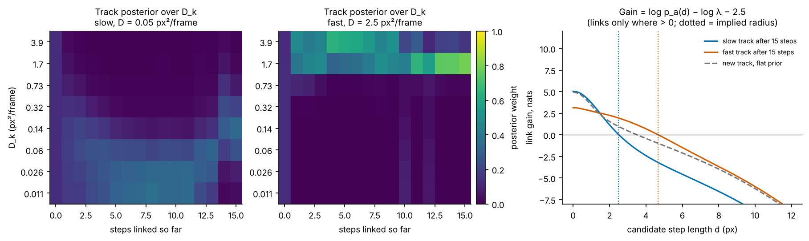
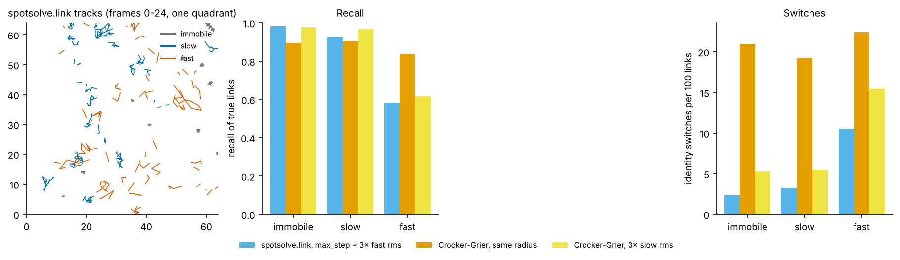
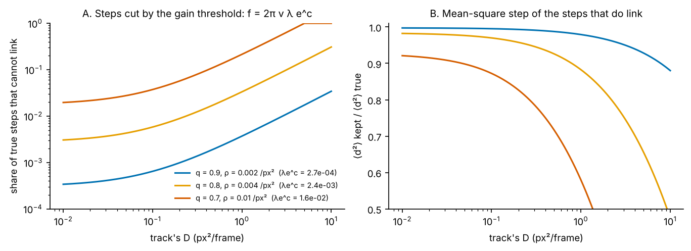

# 02 · Linking detections into tracks

*spotsolve 0.6.0. Source: `rust/spotsolve-core/src/track.rs` (model, statistics, passes) and `lap.rs` (the assignment solver). Entry points: `spotsolve.link(frame, pos, se, max_step)` and `link_with(..., strength)`.*

Linking takes the detections of frame f and of frame f + 1 and decides which pairs are the same particle. The starting point is u-track's frame-to-frame step (Jaqaman et al. 2008, stage 1, without gap closing): give each possible link a cost, give "this track ends" and "this detection starts a track" costs too, and solve one linear assignment problem per frame pair.

Everything interesting is in **what the costs are**. In a movie that mixes immobile, slow and fast particles, one search radius cannot be right for all three. A radius large enough for the fast particles lets an immobile particle steal a fast one's step. A radius small enough for the immobile ones cuts every fast track. spotsolve's answer is to let **each track carry its own belief about how fast it moves**, and to price a link by how probable that step is for that track.

---

## 1. The gain of a link

For a detection a at the end of a track and a candidate b in the next frame, the link's gain is (`Model::log_pred`, `log_lambda`)

$$
G_{ab} = \log p_a(d_{ab}) - \log\lambda_{ab} - c, \qquad c = \texttt{SWITCH\_COST} = 2.5 .
$$

A link is made only if G > 0, and each frame pair's links are the set of greatest total gain.

- **p_a(d)** is the density of a 2-D step d that a's track predicts (§2).
- **λ** is the "price of a break": the density of the alternative explanation, that a went unseen and b is new (§3).
- **c** is an extra margin. A wrong link swaps two identities, which corrupts both tracks. A missed link only splits one. Requiring log-odds above 2.5 says a switch is e^2.5 ≈ 12 times worse than a break.

**Reduction to Crocker–Grier.** If every track has the same D and λ is constant, G > 0 is a radius cut and maximising total gain is minimising total squared displacement, Crocker & Grier's (1996) rule. spotsolve generalises it.

## 2. Each track's belief about D

D is put on a grid of `N_D` = 8 values D_k, log-spaced from se²/8 (immobile for every practical purpose) to the D whose rms 2-D step is R/3, where R = `max_step`. A track's state is a probability vector w_k over that grid. The step density it predicts mixes Gaussians, one per D_k, each with per-axis variance 2D_k plus both detections' localization variances:

$$
p_a(d) = \sum_k w_k\, \mathcal N_2\!\left(d;\ 0,\ (2D_k + se_a^2 + se_b^2)\,I\right).
$$

After a link, the track's posterior is updated by Bayes' rule and then partly returned to the movie's prior (`Model::update`):

$$
w_k' \;\propto\; w_k\,\mathcal N_2(d_{ab}; 0, 2D_k + se_a^2 + se_b^2), \qquad
w' \leftarrow (1 - \phi)\, w' + \phi\, \pi_{\text{base}}, \quad \phi = \texttt{FORGET} = 0.05 .
$$

Forgetting matters for two reasons. If a track took another particle's step by mistake, it should not keep that particle's history forever. And a real particle can change mobility. This is a discrete-mode filter with a constant chance of switching mode, much like an interacting-multiple-model (IMM) tracker (Blom & Bar-Shalom 1988; Genovesio et al. 2006 for particle tracking).

π_base is the movie's population over D_k. It starts uniform and is measured by a pilot pass when detection strengths are given (`population`), from the track ends weighted by their step counts. The code comment on `FORGET` still says it returns to the "uniform prior", which was true before the pilot pass was added.

*Figure 2.1. The track posterior at work (numpy re-implementation of `update` and `log_pred`, R = 12 px, se = 0.3 px, q = 0.8, ρ = 0.004 px⁻², so log λ = −8.52). Left and middle: the posterior over D_k along a slow and a fast track. It concentrates within a few steps. Right: the gain of a step against its length. The fast track's gain stays positive out to about 4.7 px against its rms step of 3.2 px. The slow track's turns negative within a pixel or two, so a slow track will not take a fast particle's step.*

## 3. The price of a break: λ

A link competes with "a ended, b began". If q is the chance that a detection continues into the next frame and ρ is the density of detections around a detection, then:

- (1 − q)·ρ is the density of *new* detections, those not continuing anything;
- (1 − q)/q is the odds that a track goes unseen in the next frame.

So the density of the alternative is

$$
\lambda = \frac{(1 - q)^2 \rho}{q}.
$$

With detection strengths (`link_with`), q and ρ are read per strength class: up to `N_CLASSES` = 6 classes of equal share, each with at least `CLASS_ROWS` = 500 detections. Then

$$
\lambda_{ab} = \frac{1 - q_a}{q_a}\,(1 - q_b)\,\rho_b .
$$

A bright, in-focus particle is almost surely seen again, so its q is near 1 and its break price is tiny. A dim one near the detection bar often is not. Using one q for both would price a bright particle's long steps as if it flickered, and cut them.

**Reading q and ρ without links** (`movie_stats`, `class_stats`):

- **ρ** is the same-frame pair density within R.
- **q** is "detections within R in the next frame, minus the number of *other* detections expected around a detection", per detection. What remains is each detection's own continuation, however far it moved. It is averaged with the previous frame so reversing time changes nothing, and smoothed with the rule of succession.

## 4. Immobile spots: the occupancy prior

A new track has no steps yet, so where does its w start? An immobile particle leaves a column of detections at one spot, including across its own missed frames; a mobile one does not. The linker reads this from the movie (`occupancy`, `Model::prior`):

1. **The detector gap g.** Same-frame detections closer than g are merged by the detector. g is read as the radius where the same-frame pair density first reaches half its plateau (`gap`).
2. **The same-spot radius.** r₀ = max(g/2, 3√(2·se²)), capped at R.
3. **The occupancy record.** For a new track at a, it records which of the frames f ± 1…`WINDOW` (= 10) hold a detection within r₀, excluding the frame being linked.
4. **The likelihood under each D_k.** With "still" = 1 − exp(−r₀²/2v_τ), the chance the particle itself is within r₀ after |τ| frames (v_τ = 2D_k|τ| + se²), and C = 1 − exp(−ρπr₀²), the chance some *other* detection is, the chance that frame τ is occupied is

$$
\pi_\tau = 1 - (1 - p\cdot\text{still}_\tau)(1 - C).
$$

The product over frames of π_τ (occupied) or 1 − π_τ (empty), averaged over a detection probability p ∈ (0, 1) on `N_P` = 16 points, times π_base, is the new track's prior over D_k. The occupancy only informs D. It never makes a link by itself.

## 5. Both directions of time

A pass is causal: a track's history shapes its next link. After one wrong link, a track carries the other particle's history and may compound the error. The linker therefore runs forward, then again on the time-reversed movie, and keeps only the links both passes make. A link the passes disagree on becomes a break, never a switch.

## 6. Solving each frame pair: `lap.rs`

Jaqaman et al. make a frame's linking a square assignment by augmenting the T × N link block with "terminate" and "start" blocks. `lap.rs` notes that, with the bottom-right block zero, the objective is a constant plus the sum of link *gains* g = link − term − birth. That is a maximum-gain bipartite matching where nothing has to be matched. It solves that directly: every row gets a private "unmatched" column of gain 0, and the rectangular problem is solved by shortest augmenting paths (the Jonker–Volgenant family, in the form scipy uses; Crouse 2016) with Dijkstra over only the gated edges. The dense (T+N)² matrix never exists. The tests check exactness against enumerating every partial matching.

## 7. How it performs

*Figure 2.2. A simulated movie: 40 immobile particles, 60 slow (D = 0.3 px²/frame), 30 fast (D = 3), se = 0.3 px, detection probability uniform on 0.6–0.99, 60 frames. `spotsolve.link` against Crocker–Grier (scipy assignment, end cost = radius²) at the same radius, and at a radius of 3× the slow rms step. "Recall" is the share of true links made. "sw" is identity switches per 100 links.*

| Linker | Immobile: recall, sw | Slow: recall, sw | Fast: recall, sw |
|---|---|---|---|
| spotsolve | 0.98, 2.3 | 0.92, 3.2 | 0.58, 10.4 |
| Crocker–Grier, same radius | 0.90, 20.9 | 0.90, 19.2 | 0.83, 22.5 |
| Crocker–Grier, 3× slow rms | 0.98, 5.3 | 0.97, 5.5 | 0.62, 15.5 |

spotsolve keeps switches low for every population. That is its main purpose, because switches mix mobilities within a track, which no downstream model can undo. The cost is recall on the fast population.

### The price of a hard threshold

Why is fast recall only 0.58? For a track whose posterior has settled on one D_k, "G > 0" is a radius cut. With v = 2D_k + 2se² per axis,

$$
\log\frac{e^{-d^2/2v}}{2\pi v} > \log\lambda + c \iff \frac{d^2}{2v} < x_0, \quad x_0 = -\ln f,\quad f = 2\pi v\,\lambda\, e^{c}.
$$

d²/2v is exponential with rate 1 for a 2-D Gaussian step, so:

- a share **f = 2πvλe^c of the track's own true steps can never link**;
- the steps that do link have mean square smaller than the truth by the factor **1 − x₀f/(1 − f)**.

f grows in proportion to v, so the faster the particle, the larger the share of its steps that are cut.

*Figure 2.3. A: the share of a track's true steps beyond the link threshold, f = 2πvλe^c, against the track's D, for three movies (continuation q and density ρ, hence break price λ). B: the mean square of the steps that do link, as a fraction of the truth. In a dense, flickery movie (orange), a track at D = 1 px²/frame loses about 20% of its steps and its linked steps under-read the mean square by about 40%.*

Two downstream consequences (the first is direct, the second inferred):

- **Fast tracks are fragmented.** They break at their longest steps.
- **D from linked tracks is biased low for fast particles.** The long steps that would raise it are exactly the ones cut. Short fragments also enter the analysis preferentially as short tracks.

This is not a code mistake; the threshold is the design. But it is the highest-level question in this explainer. Possible directions, roughly in order of effort:

1. Report, per track, the share of its predicted step density beyond the threshold, so downstream analysis can correct for it.
2. Correct gridpost's likelihood for truncation, using a truncated Gaussian for each displacement given its track's linking radius.
3. Add gap closing (u-track stage 2), which would rejoin fragments.

## Standard or new?

| Piece | Status | Reference to check |
|---|---|---|
| Frame-to-frame LAP with birth/death alternatives | Standard | Jaqaman et al. 2008, *Nat. Methods* 5:695 |
| Least-squares-displacement linking as the one-D limit | Standard | Crocker & Grier 1996, *J. Colloid Interface Sci.* 179:298 |
| Sparse JV/Dijkstra solver with private "unmatched" columns | Standard algorithm, tidy reformulation | Jonker & Volgenant 1987; Crouse 2016, *IEEE TAES* 52:1679 |
| Per-track adaptive motion model | Standard idea (u-track adapts its Kalman search radius) | Jaqaman 2008; Genovesio et al. 2006, *IEEE TIP* 15:1062 (IMM) |
| A grid posterior over D per track, with forgetting, inside the link cost | Appears new for SPT linking | Compare Blom & Bar-Shalom 1988, *IEEE TAC* 33:780 (IMM) |
| λ = (1 − q)²ρ/q, read from the movie without links | Appears new | — |
| Per-strength-class continuation | Appears new | — |
| Occupancy prior for immobile spots | Appears new | — |
| Forward/backward consensus | Appears new for SPT linking (used elsewhere as a "mutual best" check) | — |
| Explicit switch-cost margin | Appears new in this form | — |
