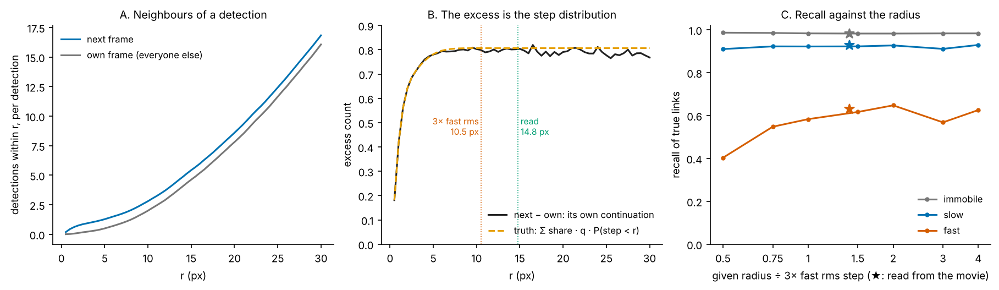
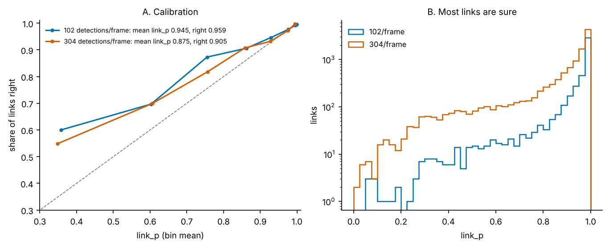
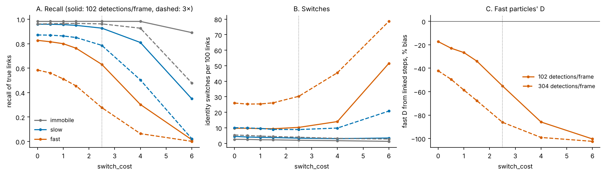

# 02 · Linking detections into tracks

*spotsolve 0.6.0 plus the linking changes of spotsolve PRs #4 (`link_p`) and #5 (the search radius read from the movie, `switch_cost` exposed), not yet released. Source: `rust/spotsolve-core/src/track.rs` (model, statistics, passes, search radius, link marginals) and `lap.rs` (the assignment solver). Entry points: `spotsolve.link(locs, search_radius=None, switch_cost=2.5)` and `spotsolve.search_radius(locs)`; in Rust, `link_with(frame, pos, se, strength, radius, switch_cost)` and `search_radius(frame, pos, se)`. In napari-gemscape2 these are the Track tab's "search radius" (auto by default) and "switch cost".*

Linking takes the detections of frame f and of frame f + 1 and decides which pairs are the same particle. The starting point is u-track's frame-to-frame step (Jaqaman et al. 2008, stage 1, without gap closing): give each possible link a cost, give "this track ends" and "this detection starts a track" costs too, and solve one linear assignment problem per frame pair.

Everything interesting is in **what the costs are**. In a movie that mixes immobile, slow and fast particles, one search radius cannot be right for all three. A radius large enough for the fast particles lets an immobile particle steal a fast one's step. A radius small enough for the immobile ones cuts every fast track. spotsolve's answer is to let **each track carry its own belief about how fast it moves**, and to price a link by how probable that step is for that track. The search radius then only has to be large enough, so spotsolve reads it from the movie (§6), and every link it makes comes with a probability of being right (§8).

---

## 1. The gain of a link

For a detection a at the end of a track and a candidate b in the next frame, the link's gain is (`Model::log_pred`, `log_lambda`)

$$
G_{ab} = \log p_a(d_{ab}) - \log\lambda_{ab} - c, \qquad c = \texttt{switch\_cost}\ (\text{default } \texttt{SWITCH\_COST} = 2.5) .
$$

A link is made only if G > 0, and each frame pair's links are the set of greatest total gain.

- **p_a(d)** is the density of a 2-D step d that a's track predicts (§2).
- **λ** is the "price of a break": the density of the alternative explanation, that a went unseen and b is new (§3).
- **c** is an extra margin. A wrong link swaps two identities, which corrupts both tracks. A missed link only splits one. Requiring log-odds above 2.5 says a switch is e^2.5 ≈ 12 times worse than a break. This is a choice about the analysis, not something the movie can tell, so it is the one setting the linker exposes (`switch_cost`). §9 shows what it trades.

**Reduction to Crocker–Grier.** If every track has the same D and λ is constant, G > 0 is a radius cut and maximising total gain is minimising total squared displacement, Crocker & Grier's (1996) rule. spotsolve generalises it.

## 2. Each track's belief about D

D is put on a grid of `N_D` = 8 values D_k, log-spaced from se²/8 (immobile for every practical purpose) to the D whose rms 2-D step is R/3, where R is the search radius (read from the movie by default, §6). A track's state is a probability vector w_k over that grid. The step density it predicts mixes Gaussians, one per D_k, each with per-axis variance 2D_k plus both detections' localization variances:

$$
p_a(d) = \sum_k w_k\, \mathcal N_2\!\left(d;\ 0,\ (2D_k + se_a^2 + se_b^2)\,I\right).
$$

After a link, the track's posterior is updated by Bayes' rule and then partly returned to the movie's prior (`Model::update`):

$$
w_k' \;\propto\; w_k\,\mathcal N_2(d_{ab}; 0, 2D_k + se_a^2 + se_b^2), \qquad
w' \leftarrow (1 - \phi)\, w' + \phi\, \pi_{\text{base}}, \quad \phi = \texttt{FORGET} = 0.05 .
$$

Forgetting matters for two reasons. If a track took another particle's step by mistake, it should not keep that particle's history forever. And a real particle can change mobility. This is a discrete-mode filter with a constant chance of switching mode, much like an interacting-multiple-model (IMM) tracker (Blom & Bar-Shalom 1988; Genovesio et al. 2006 for particle tracking).

π_base is the movie's population over D_k. It starts uniform and is measured by a pilot pass when detection strengths are given (`population`), from the track ends weighted by their step counts. The code comment on `FORGET` still says it returns to the "uniform prior", which was true before the pilot pass was added.

*Figure 2.1. The track posterior at work (numpy re-implementation of `update` and `log_pred`, R = 12 px, se = 0.3 px, q = 0.8, ρ = 0.004 px⁻², so log λ = −8.52). Left and middle: the posterior over D_k along a slow and a fast track. It concentrates within a few steps. Right: the gain of a step against its length. The fast track's gain stays positive out to about 4.7 px against its rms step of 3.2 px. The slow track's turns negative within a pixel or two, so a slow track will not take a fast particle's step.*

## 3. The price of a break: λ

A link competes with "a ended, b began". If q is the chance that a detection continues into the next frame and ρ is the density of detections around a detection, then:

- (1 − q)·ρ is the density of *new* detections, those not continuing anything;
- (1 − q)/q is the odds that a track goes unseen in the next frame.

So the density of the alternative is

$$
\lambda = \frac{(1 - q)^2 \rho}{q}.
$$

With detection strengths (`link_with`), q and ρ are read per strength class: up to `N_CLASSES` = 6 classes of equal share, each with at least `CLASS_ROWS` = 500 detections. Then

$$
\lambda_{ab} = \frac{1 - q_a}{q_a}\,(1 - q_b)\,\rho_b .
$$

A bright, in-focus particle is almost surely seen again, so its q is near 1 and its break price is tiny. A dim one near the detection bar often is not. Using one q for both would price a bright particle's long steps as if it flickered, and cut them.

**Reading q and ρ without links** (`movie_stats`, `class_stats`):

- **ρ** is the same-frame pair density within R.
- **q** is "detections within R in the next frame, minus the number of *other* detections expected around a detection", per detection. What remains is each detection's own continuation, however far it moved. It is averaged with the previous frame so reversing time changes nothing, and smoothed with the rule of succession.

## 4. Immobile spots: the occupancy prior

A new track has no steps yet, so where does its w start? An immobile particle leaves a column of detections at one spot, including across its own missed frames; a mobile one does not. The linker reads this from the movie (`occupancy`, `Model::prior`):

1. **The detector gap g.** Same-frame detections closer than g are merged by the detector. g is read as the radius where the same-frame pair density first reaches half its plateau (`gap`).
2. **The same-spot radius.** r₀ = max(g/2, 3√(2·se²)), capped at R.
3. **The occupancy record.** For a new track at a, it records which of the frames f ± 1…`WINDOW` (= 10) hold a detection within r₀, excluding the frame being linked.
4. **The likelihood under each D_k.** With "still" = 1 − exp(−r₀²/2v_τ), the chance the particle itself is within r₀ after |τ| frames (v_τ = 2D_k|τ| + se²), and C = 1 − exp(−ρπr₀²), the chance some *other* detection is, the chance that frame τ is occupied is

$$
\pi_\tau = 1 - (1 - p\cdot\text{still}_\tau)(1 - C).
$$

The product over frames of π_τ (occupied) or 1 − π_τ (empty), averaged over a detection probability p ∈ (0, 1) on `N_P` = 16 points, times π_base, is the new track's prior over D_k. The occupancy only informs D. It never makes a link by itself.

## 5. Both directions of time

A pass is causal: a track's history shapes its next link. After one wrong link, a track carries the other particle's history and may compound the error. The linker therefore runs forward, then again on the time-reversed movie, and keeps only the links both passes make. A link the passes disagree on becomes a break, never a switch. The two passes also give each kept link two opinions of how sure it is, one from its past and one from its future, which is where `link_p` comes from (§8).

## 6. The search radius, read from the movie

R used to be `max_step`, a number the user had to set: about three times the rms step of the fastest particles of interest. Everything in §1–§4 makes R *soft*. Inside it, a link is decided by the track's own step density against λ and c, so a larger R adds candidates the gain refuses anyway. R only has to be large enough. That makes it something the movie can supply (`search_radius` in `track.rs`, `spotsolve.search_radius` in Python), without any links:

1. **Pair counts.** Around each detection, count the detections within r in the next frame, N₁(r), and the *other* detections within r in its own frame, N₀(r). The next-frame count is the detection's own continuation, wherever it moved, plus everyone else. The own-frame count is everyone else. So N₁ − N₀ is the continuation q times the cumulative step distribution (Figure 2.4 B). This is the subtraction the continuation q of §3 already uses, now read as a function of r. Below twice the detector gap g, the own-frame count is emptied by the detector's merging, so the background there is the plateau's density scaled as r².
2. **Fit.** The excess is fitted as a non-negative mixture (NNLS, `PAIR_D` = 24 log-spaced D) of 2-D Gaussian step distributions, each with the localization variance added:

$$
N_1(r) - N_0(r) \;\approx\; \sum_j a_j \left(1 - e^{-r^2 / (4D_j + 4\,se^2)}\right), \qquad a_j \ge 0 .
$$

3. **Window.** Pairs are counted out to four mean nearest-neighbour spacings, W = 2/√(detections per unit area per frame). The D grid stops at W²/36, the D whose three rms steps fill the window: a faster step is lost among the neighbours for any linker. Without this cap the fit could put weight on steps longer than the window can show, and the radius ran away on sparse and on immobile movies.
4. **Radius.** The fastest D_j holding at least 3% of the fitted weight (`PAIR_TOP`) sets R = 1.5 × 6√(D_j + se²): 1.5 times (`PAIR_MARGIN`) the radius whose grid tops out at that D. The margin covers the pair count reading the fastest D up to a quarter low.

*Figure 2.4. The radius on the movie of Figure 2.2 (40 immobile, 60 slow, 30 fast particles, 102 detections per frame). A: neighbours of a detection in the next frame and in its own frame (numpy re-implementation of the counting step). B: their difference, against what the truth predicts (each class's share × its continuation × the chance its step is shorter than r). The read radius, 14.8 px, is 1.4× the rule of three fast rms steps. C: `spotsolve.link` at given radii from half to four times the rule (lines) and at the radius it reads (stars). Recall is flat from the rule upward and falls below it.*

Out of sample, on 19 simulated movies (2-D mixtures with fast D from 1 to 8 px²/frame, single populations from immobile to fast, 230–860 detections per frame, and 3-D beads in a slab), the read radius came out at 1.4–3× the rule, and up to 33× on immobile-only movies, where the rule's radius is tiny. Its links matched the rule's: recall within 1.5 points, wrong links within 0.6 points (spotsolve's `docs/TRACKING.md`). On 0007, a real GEM movie at 653 detections per frame, it reads 29.6 px and makes 18,673 links against 18,694 at a hand-set 20 px.

A given `search_radius` still overrides it. It should be at least three rms steps of the fastest particles of interest; a smaller one is the only way the radius costs links (half the rule costs 15–25 points of fast recall, Figure 2.4 C).

## 7. Solving each frame pair: `lap.rs`

Jaqaman et al. make a frame's linking a square assignment by augmenting the T × N link block with "terminate" and "start" blocks. `lap.rs` notes that, with the bottom-right block zero, the objective is a constant plus the sum of link *gains* g = link − term − birth. That is a maximum-gain bipartite matching where nothing has to be matched. It solves that directly: every row gets a private "unmatched" column of gain 0, and the rectangular problem is solved by shortest augmenting paths (the Jonker–Volgenant family, in the form scipy uses; Crouse 2016) with Dijkstra over only the gated edges. The dense (T+N)² matrix never exists. The tests check exactness against enumerating every partial matching.

## 8. How sure each link is: `link_p`

A link either is or is not made, but some links are certain and others are a coin toss between two neighbours. Within one frame pair, each pass already knows every candidate link's odds against "a went unseen and b is new", ψ_ab = p_a(d_ab)/λ_ab: the gain of §1 before the switch cost. The probability that a particular link is right sums over every way the rest of the frame pair could be matched. That sum is a permanent and cannot be computed exactly, but loopy belief propagation over the one-to-one constraint approximates it well (Williams & Lau 2014). With messages μ from track ends a to detections b and ν back (`bp_marginals`, damped by half),

$$
\mu_{a\to b} = \frac{\psi_{ab}}{1 + \sum_{b' \ne b} \psi_{ab'}\,\nu_{b'\to a}}, \qquad
\nu_{b\to a} = \frac{1}{1 + \sum_{a' \ne a} \mu_{a'\to b}}, \qquad
P(a \to b) = \frac{\psi_{ab}\,\nu_{b\to a}}{1 + \sum_{b'} \psi_{ab'}\,\nu_{b'\to a}} .
$$

The 1s are "a unmatched" and "b unmatched", each with odds 1. On a tree of candidate links (no loops) this is exact, and the tests check it against enumeration.

Each pass gives a marginal for each link it keeps: the forward pass from the track's past, the backward pass from its future. **`link_p` is their product**, because a link must survive both passes to be kept. It sits on the link's later row, and is null where a track starts. It annotates the links and never changes them: on 0007 the track ids are identical with and without it.

*Figure 2.5. `link_p` against the share of links that are right, on the movie of Figure 2.2 and on the same box with three times the particles. A: links binned by `link_p`. B: how `link_p` is spread. Most links are near-certain. A fast particle's link is doubtful far more often: at 102 detections per frame, 37% of fast links have `link_p` below 0.9, against 11% of slow and 5% of immobile ones.*

How it was chosen and how well it holds:

- **Calibration.** On four simulated movies (2-D mixed mobility at 460 and 720 detections per frame, 3-D beads in a slab at 1× and 3×), the mean `link_p` is within a point of the share of links that are right. On this explainer's movie it is 1.4 points low at 102 per frame and 3 points low at 3×; on spotsolve's confined-disc test movies, 3.6 points low.
- **Why the product.** Each direction's marginal alone, their mean or their minimum ran 1–3 points *over*confident. The two directions see overlapping evidence, so their product double-counts some of it and errs low, which is the safer side.
- **On real data.** On 0007, the share of spotsolve's links that an independent sampler over linkings (§10) also makes rises with `link_p`, bin by bin: 99.8% at ≥ 0.999, 96.7% at 0.95–0.99, 92% at 0.9–0.95, 86.5% at 0.8–0.9, and 64% below 0.5. Links below 0.9 hold 7.1% long steps, against 1.4% at 0.9 and above.

What to do with it: weight or filter steps downstream. napari-gemscape2 reports the run's mean `link_p` as the share of links expected right, and offers each track's weakest link (`min_link_p`) as a track filter. A filter on `link_p` can drop doubtful links. It cannot add the ones the linker refused: only a lower `switch_cost` does that.

## 9. How it performs

*Figure 2.2. A simulated movie: 40 immobile particles, 60 slow (D = 0.3 px²/frame), 30 fast (D = 3), se = 0.3 px, detection probability uniform on 0.6–0.99, 60 frames, 102 detections per frame. `spotsolve.link` with its defaults (radius read from the movie: 14.8 px; switch cost 2.5) against Crocker–Grier (scipy assignment, end cost = radius²) at the same radius, and at a radius of 3× the slow rms step. "Recall" is the share of true links made. "sw" is identity switches per 100 links.*

| Linker | Immobile: recall, sw | Slow: recall, sw | Fast: recall, sw |
|---|---|---|---|
| spotsolve | 0.98, 2.0 | 0.93, 3.3 | 0.63, 10.3 |
| Crocker–Grier, same radius | 0.82, 30.9 | 0.82, 30.0 | 0.79, 30.4 |
| Crocker–Grier, 3× slow rms | 0.98, 5.7 | 0.97, 5.4 | 0.62, 15.2 |

spotsolve keeps switches low for every population. That is its main purpose, because switches mix mobilities within a track, which no downstream model can undo. The cost is recall on the fast population.

### The price of a hard threshold

Why is fast recall only 0.63? For a track whose posterior has settled on one D_k, "G > 0" is a radius cut. With v = 2D_k + 2se² per axis,

$$
\log\frac{e^{-d^2/2v}}{2\pi v} > \log\lambda + c \iff \frac{d^2}{2v} < x_0, \quad x_0 = -\ln f,\quad f = 2\pi v\,\lambda\, e^{c}.
$$

d²/2v is exponential with rate 1 for a 2-D Gaussian step, so:

- a share **f = 2πvλe^c of the track's own true steps can never link**;
- the steps that do link have mean square smaller than the truth by the factor **1 − x₀f/(1 − f)**.

f grows in proportion to v, so the faster the particle, the larger the share of its steps that are cut.

*Figure 2.3. A: the share of a track's true steps beyond the link threshold, f = 2πvλe^c, against the track's D, for three movies (continuation q and density ρ, hence break price λ). B: the mean square of the steps that do link, as a fraction of the truth. In a dense, flickery movie (orange), a track at D = 1 px²/frame loses about 20% of its steps and its linked steps under-read the mean square by about 40%.*

Two downstream consequences (the first is direct, the second inferred):

- **Fast tracks are fragmented.** They break at their longest steps.
- **D from linked tracks is biased low for fast particles.** The long steps that would raise it are exactly the ones cut. Short fragments also enter the analysis preferentially as short tracks.

This is not a code mistake; the threshold is the design. But it is the highest-level question in this explainer.

### What `switch_cost` trades

c enters f directly: f = 2πvλe^c, so every unit of c multiplies the share of a track's steps that cannot link by e. Lowering c is the one way to let the linker make the long steps it now refuses, and it buys them with swaps.

*Figure 2.6. `spotsolve.link` (radius read from the movie) on the movie of Figure 2.2 (solid) and at three times the particles (dashed), at switch costs from 0 to 6. A: recall per class. B: identity switches per 100 links. C: the fast particles' D read from their linked one-frame steps (mean d²/4 − se²), against the true 3 px²/frame. The dotted line is the default.*

| 102 detections/frame | c = 0 | 1 | 2.5 (default) | 4 | 6 |
|---|---|---|---|---|---|
| fast recall | 0.83 | 0.80 | 0.63 | 0.30 | 0.01 |
| fast switches per 100 links | 9.7 | 9.5 | 10.3 | 14.0 | 52 |
| slow recall | 0.96 | 0.96 | 0.93 | 0.81 | 0.35 |
| fast D from linked steps | −17% | −27% | −55% | −86% | −100% |

What this says:

- **Recall falls with c, and fastest for the fastest particles.** That is f = 2πvλe^c at work, and it is the price the switch cost is meant to charge. Immobile particles barely notice: their steps sit far inside the threshold at any c.
- **Swaps do not fall much below the default on this movie.** For the fast class they are flat from 0 to 2.5 and rise beyond, because at high c the few fast links left are the ones where a neighbour happened to sit close. On the crowded movies of spotsolve's own sweep (230–870 detections per frame, fast D 2 px²/frame or slab beads), lowering c from 2.5 to 0 roughly doubled wrong links (1.9% → 4.5%, 5.3% → 9.2%, 5.7% → 13.1%) while recall rose by at most 3 points.
- **How much recall moves depends on the movie.** spotsolve's sweep saw recall fall only from 0.97 to 0.95 between c = 0 and 4 on its least crowded movie. This movie loses far more, because its fast particles are faster relative to the spacing, and flickery (λ grows as (1 − q)²/q).
- **D from linked steps is biased low by the missed long steps, and high by swaps.** In spotsolve's sweep the two cancelled near c = 1; here nothing cancels, because swaps barely change with c. Do not tune c to make a D come out right: read D downstream with the truncation in mind, or correct it by matched simulation.

Possible directions, roughly in order of effort:

1. Lower `switch_cost` when the fastest particles are the point of the experiment, and use `link_p` (§8) to drop or down-weight the doubtful links it adds.
2. Correct D for the truncation downstream: gridpost's likelihood with a truncated Gaussian for each displacement given its link's acceptance threshold. The gate alone under-predicts the cut (the assignment and the two-pass consensus remove more long steps), so the most reliable correction found so far is a matched simulation: link a movie simulated with the real one's density, continuation and se, and read the bias off it.
3. Gap closing (u-track stage 2) would rejoin fragments. A prototype that put gap links into the same assignment was tested and is not worth adding by default: on simulated 3-D slab beads and on 0007, misses come in runs as particles leave focus, and its gap links were 8–14% wrong.

## 10. How close to the best possible?

To ask whether a better frame-to-frame linker exists, a sampler over whole linkings was built as a benchmark (a numba prototype, not part of the packages). It samples which detection follows which, with each track's D summed out on a grid, and Gibbs-samples everything the linking depends on: the population over D, continuation and survival per strength class, a clutter density for junk, and each track's hidden distance from the focal plane, which diffuses with the track's own D and emits "missed" or a strength class. The depth grid ends in an absorbing "gone" state, and detection is constrained never to rise with distance from focus; without these, the far depth bins (which the data hardly constrain) drifted into a second "visible" state on real data.

- **On simulated slab beads,** its D interval covers the truth on the clean movies at 1× and 3× density (−2.2% [−4.2, 0.0] and −0.7% [−2.2, +0.4]), where spotsolve's linked steps read 5–14% low. With junk it still reads 2–4% high. Thresholded at 0.9, its links make fewer errors than spotsolve's at 3× density, at somewhat lower recall.
- **On 0007,** 96.7% of spotsolve's links have a sampler marginal above 0.5. The sampler adds about 2,100 gap links and roughly doubles track length, with a slightly heavier step tail. Its lag-1 D is 0.42 µm²/s against spotsolve's 0.39: the gap the simulations predict, with the truth between the two.

So spotsolve's frame-to-frame links are close to what the data support: the disagreements are concentrated where `link_p` is low, and the main headroom is in what the linker knows about each particle (its mobility, its depth), not in the optimization. Full Bayes is honest only when its generative model is right; on movies it does not model, its posterior is narrow and wrong. It stays a benchmark, not a replacement.

## Standard or new?

| Piece | Status | Reference to check |
|---|---|---|
| Frame-to-frame LAP with birth/death alternatives | Standard | Jaqaman et al. 2008, *Nat. Methods* 5:695 |
| Least-squares-displacement linking as the one-D limit | Standard | Crocker & Grier 1996, *J. Colloid Interface Sci.* 179:298 |
| Sparse JV/Dijkstra solver with private "unmatched" columns | Standard algorithm, tidy reformulation | Jonker & Volgenant 1987; Crouse 2016, *IEEE TAES* 52:1679 |
| Per-track adaptive motion model | Standard idea (u-track adapts its Kalman search radius) | Jaqaman 2008; Genovesio et al. 2006, *IEEE TIP* 15:1062 (IMM) |
| A grid posterior over D per track, with forgetting, inside the link cost | Appears new for SPT linking | Compare Blom & Bar-Shalom 1988, *IEEE TAC* 33:780 (IMM) |
| λ = (1 − q)²ρ/q, read from the movie without links | Appears new | — |
| Per-strength-class continuation | Appears new | — |
| Occupancy prior for immobile spots | Appears new | — |
| Forward/backward consensus | Appears new for SPT linking (used elsewhere as a "mutual best" check) | — |
| Explicit switch-cost margin, exposed as the one setting | Appears new in this form | — |
| Search radius read from next-frame against own-frame pair counts | Related to tracking-free displacement analysis from pair correlations (PICS); using it to set a linker's radius appears new | Semrau & Schmidt 2007, *Biophys. J.* 92:613 |
| Link marginals by loopy BP over one frame pair's matchings | Standard | Williams & Lau 2014, *IEEE TAES* 50:2942 |
| `link_p` as the product of the forward and backward passes' marginals | Appears new | — |
