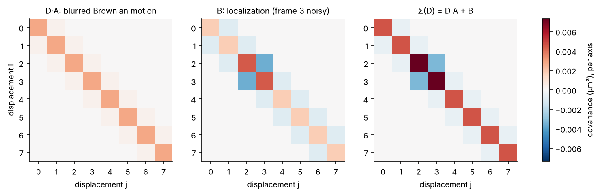
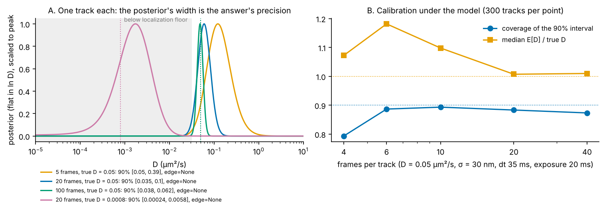

# 03 · D for one track: the exact Brownian likelihood

*diffusionkit main. Source: `diffusionkit/gridpost/likelihood.py` (`motion_covariance`, `localization_covariance`, `brownian_loglik_batch`), `gridpost/posterior.py` (`track_loglik`, `summary`, `information_bits`, `localization_floor`, `grid_edge`), `gridpost/workflow.py` (`analyze_tracks`).*

The classic way to get D from a track is to fit a line to its mean-squared displacement (explainer 07). That throws information away. The MSD at different lags is built from overlapping displacements, so its points are strongly correlated, and the usual fit treats them as independent. The better route, worked out by Berglund (2010) and Michalet & Berglund (2012), writes down the *exact* distribution of a track's displacements under Brownian motion with localization noise and camera blur, and uses that likelihood directly.

gridpost evaluates that likelihood on a fine grid of D and reports each track's whole posterior.

---

## 1. What one displacement looks like

Per axis, a track of n frames has m = n − 1 displacements Δᵢ = xᵢ₊₁ − xᵢ. Three things shape them.

**Motion.** Brownian motion over one frame interval Δt has variance 2DΔt per axis.

**Blur.** The camera does not see an instant. It averages the position over the exposure t_e. For a box shutter (Berglund 2010), with R = t_e / (6Δt):

- each displacement's motion variance shrinks to 2DΔt(1 − 2R);
- *adjacent* displacements share part of the same exposure, so they become positively correlated, with covariance 2DΔt·R;
- displacements further apart are uncorrelated.

**Localization error.** Each position xᵢ carries an independent error of SD sᵢ (the per-frame SD the detector reports). It enters both displacements that touch frame i, with opposite signs: Δᵢ₋₁ gets +εᵢ and Δᵢ gets −εᵢ. So the displacement variance gains sᵢ² + sᵢ₊₁², and adjacent displacements gain covariance −sᵢ₊₁².

Altogether the displacements are jointly Gaussian with covariance

$$
\Sigma(D) = D\,A + B,
$$

$$
A_{ii} = 2\Delta t(1 - 2R),\quad A_{i,i+1} = 2\Delta t\,R;\qquad
B_{ii} = s_i^2 + s_{i+1}^2,\quad B_{i,i+1} = -s_{i+1}^2 .
$$

*Figure 3.1. The covariance of 8 displacements, made with the real `motion_covariance` and `localization_covariance` (D = 0.05 µm²/s, Δt = 35 ms, exposure 20 ms, s = 30 nm, with frame 3 localized twice as poorly). Motion makes a positive band, localization a negative off-diagonal, and one noisy frame leaves its own cross.*

Using each frame's own reported SD rather than one average SD is the approach of Relich et al. (2016). It matters when a track's brightness varies, because a dim frame's position is then down-weighted automatically.

## 2. Evaluating the likelihood fast

The log-likelihood of one axis is the usual Gaussian one:

$$
\ell(D) = -\tfrac12\left[m\log 2\pi + \log\det\Sigma(D) + \Delta^\top\Sigma(D)^{-1}\Delta\right],
$$

summed over the two axes. Σ is tridiagonal, so an LDLᵀ factorisation is a two-term recursion along the track. With diagonal aᵢ and off-diagonal bᵢ,

$$
d_1 = a_1,\qquad d_{i+1} = a_{i+1} - \frac{b_i^2}{d_i},\qquad
y_1 = \Delta_1,\qquad y_{i+1} = \Delta_{i+1} - \frac{b_i}{d_i}\,y_i ,
$$

$$
\ell(D) = -\tfrac12\sum_i\left[\log(2\pi d_i) + \frac{y_i^2}{d_i}\right].
$$

That is O(m) per grid point per track. `brownian_loglik_batch` runs it for every grid point and every track of one length at once. (`docs/gridpost.md` still describes an eigen-whitening here; the code's docstring correctly says LDLᵀ. The eigen-whitening lives in `fbmpost`, explainer 04.)

## 3. The grid posterior

D is put on a grid of 601 points evenly spaced in u = ln D from 10⁻⁵ to 10 µm²/s (`GridPostOptions.u_D`). The prior is flat in ln D, so log-uniform in D. That is scale-free: it does not care whether D is quoted in µm²/s or nm²/ms. The posterior is just the normalised likelihood on the grid:

$$
p(u_j \mid \text{track}) \propto \exp\{\ell(e^{u_j})\}.
$$

Each track is reported with (`posterior.summary`, `workflow._posterior_D`):

- **E[D]**, the posterior mean, as the one point estimate. Under the 1/D prior it reads high for short tracks, by about 1/(n − 2) in the noise-free limit. The docstring says so and points to the population models for averages.
- **An equal-tailed 90% interval** (`D_post_lo_um2_s`, `D_post_hi_um2_s`).
- **Information in bits**, the KL divergence of the posterior from the prior (`information_bits`). Each bit roughly halves the plausible range of ln D.
- **The localization floor**, D_floor = ⟨s²⟩ / (Δt − t_e/3) (`localization_floor`). Below it, a displacement's motion variance is smaller than its noise variance. It is a reference scale, not a cutoff: the posterior already accounts for the noise.
- **`grid_edge`**, which says whether the posterior is cut by an end of the grid (weight at the edge > 5% of the peak). "low" means the data only bound D from above, so the interval's lower end is set by the grid, not the data.

*Figure 3.2. A: posteriors of single tracks (`track_loglik` on tracks from `simulate_tracks`, which averages the motion over the exposure on a fine time grid, independently of the closed form). Longer tracks give narrower posteriors. A track with D well below the floor (purple) gives a posterior that only bounds D from above and runs into the grid's low edge. B: calibration over 300 tracks per point at D = 0.05 µm²/s.*

## Calibration

| Frames per track | 4 | 6 | 10 | 20 | 40 |
|---|---|---|---|---|---|
| Coverage of the 90% interval | 0.79 | 0.89 | 0.89 | 0.88 | 0.87 |
| Median E[D] / true D | 1.07 | 1.18 | 1.10 | 1.01 | 1.01 |

Coverage is close to nominal from 6 frames up. At 4 frames it falls to 0.79, and at 3–5 frames, in a separate check, the truth lay *above* the upper bound 13–18% of the time instead of 5%.

That is not a bug. A Bayesian interval is calibrated *on average over the prior*, not at each fixed true D. With few displacements, the likelihood is broad, and the flat-in-ln-D prior has a long stretch of mass below the floor where the data cannot discriminate. The posterior leans down into that stretch. The population models (explainer 05) are the right place to fix this, because there the prior is learned from the tracks themselves.

## Standard or new?

| Piece | Status | Reference to check |
|---|---|---|
| Σ(D) = DA + B with box-shutter blur | Standard | Berglund 2010, *Phys. Rev. E* 82:011917; Michalet & Berglund 2012, *Phys. Rev. E* 85:061916 |
| Per-frame localization SDs in B | Standard | Relich et al. 2016, *Phys. Rev. E* 93:042401 |
| O(m) tridiagonal recursion | Standard numerics | — |
| Grid posterior in ln D, reported with information bits, the floor and a grid-edge flag | The reporting is new in this combination; the method is a straightforward Bayesian treatment | — |
