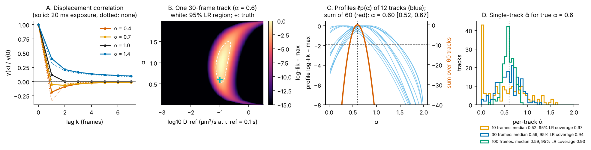
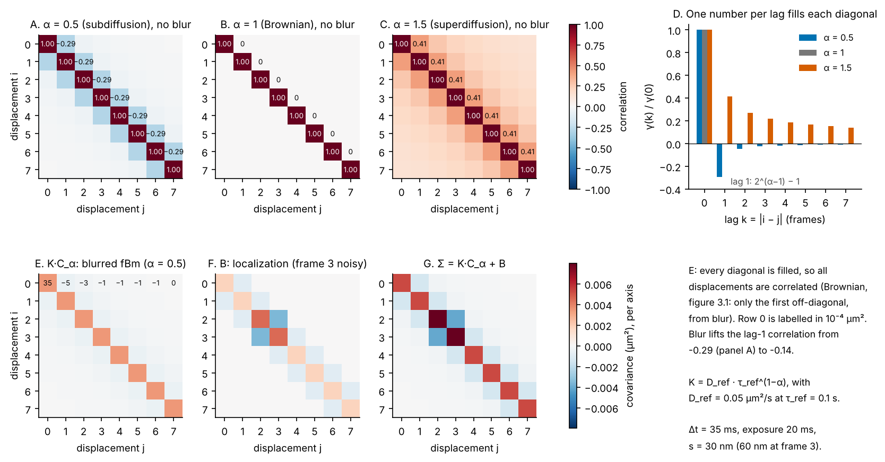

# 04 · Anomalous diffusion: α by profile likelihood

*diffusionkit main. Source: `diffusionkit/fbmpost/covariance.py` (`fgn_autocovariance`, `fgn_motion_covariance`), `fbmpost/likelihood.py` (`whiten_batch`, `loglik_points`, `log_likelihood_surface`), `fbmpost/profile.py` (`profile_K`, `summarize`), `fbmpost/population.py` (`shared_alpha`, `deconvolve_tracks`), `fbmpost/workflow.py` (`analyze_tracks`).*

Inside a cell, many particles do not diffuse freely. Their mean-squared displacement grows as τ^α with α < 1 (subdiffusion, e.g. crowding or viscoelasticity) or α > 1 (superdiffusion, e.g. active transport). The usual estimate of α is the slope of log MSD against log τ. It is fragile: localization noise bends the curve at short lags, and the long lags are noisy and few (explainer 07, figure 7.1A).

fbmpost does for α what gridpost does for D. It writes down the exact likelihood of a track under **fractional Brownian motion** (fBm) with blur and localization noise, and reads α from it.

---

## 1. The model: fractional Brownian motion

Per axis, fBm has the structure function

$$
\mathbb E\big[(z(t+s) - z(t))^2\big] = 2K\,|s|^\alpha ,
$$

so the MSD is 2Kτ^α per axis. K is a generalised diffusion coefficient with units µm²/s^α. Its displacements over equal frame intervals, *fractional Gaussian noise*, are stationary and correlated:

- negatively correlated for α < 1, so the path tends to step back;
- positively correlated for α > 1, so it keeps going;
- uncorrelated only at α = 1, which is Brownian motion.

**Blur.** With a box exposure t_e, each frame records the average position over [0, t_e]. With G(x) = E|x + u − v|^α for independent u, v uniform on [0, t_e], the blurred displacement autocovariance per unit K is

$$
\gamma(k) = G((k+1)\Delta t) - 2G(k\Delta t) + G((k-1)\Delta t).
$$

The code evaluates G exactly, as (H(x+t_e) − 2H(x) + H(x−t_e))/t_e² with H(x) = |x|^{α+2}/((α+1)(α+2)). Where t_e/x is small and that difference loses precision to cancellation, it switches to a binomial series (`_blurred_abs_power`). I checked by hand that at α = 1 this reproduces Berglund's Brownian blur exactly, so gridpost is the α = 1 special case.

*Figure 4.2. A: the displacement correlation γ(k)/γ(0) from the real `fgn_autocovariance`, with a 20 ms exposure (solid) and none (dotted). Subdiffusion makes the lag-1 correlation negative. Blur adds a positive lag-1 correlation even at α = 1. B: one 30-frame track's log-likelihood over (α, log₁₀ D_ref) from `log_likelihood_surface`, with the 95% likelihood-ratio region in white. C: profile likelihoods of α for twelve 20-frame tracks (blue) and their sum over 60 tracks (red). D: single-track α̂ for true α = 0.6 at three track lengths.*

## 2. Building the covariance matrix, entry by entry

As in figure 3.1, a track of n frames has m = n − 1 displacements per axis, and their covariance is an m × m matrix whose entry (i, j) is the covariance of displacements i and j. For fBm it is built in three steps.

**Step 1: one entry from the structure function.** Write displacement i as b − a and displacement j as d − c, with a = z(tᵢ), b = z(tᵢ + Δt), c = z(tⱼ), d = z(tⱼ + Δt). The algebraic identity

$$
(b-a)(d-c) = \tfrac12\big[(a-d)^2 + (b-c)^2 - (a-c)^2 - (b-d)^2\big]
$$

turns a product of two displacements into four squared differences, and the structure function gives the expectation of each: E[(z(t+s) − z(t))²] = 2K|s|^α. If the two displacements are k = |i − j| frames apart, the four time gaps are (k+1)Δt, (k−1)Δt, kΔt and kΔt, so

$$
\operatorname{cov}(\Delta_i, \Delta_j) = K\,\Delta t^{\alpha}\big(|k+1|^\alpha - 2|k|^\alpha + |k-1|^\alpha\big) \equiv K\,\gamma(k).
$$

The entry depends only on the lag k, so each diagonal of the matrix holds one number (a Toeplitz matrix): γ(0) on the main diagonal, γ(1) on the first off-diagonal, and so on. That is the whole recipe; the matrix is C_α[i, j] = γ(|i − j|).

- **The main diagonal** is γ(0) = 2Δt^α: each displacement's own variance, the per-frame MSD.
- **At α = 1** the bracket is (k+1) − 2k + (k−1) = 0 for every k ≥ 1, so every off-diagonal vanishes: Brownian displacements are independent.
- **For α < 1** the bracket is negative at every lag, for α > 1 positive. The lag-1 correlation is γ(1)/γ(0) = 2^(α−1) − 1: −0.29 at α = 0.5, +0.41 at α = 1.5.
- **The correlations decay slowly**, like α(α − 1)k^(α−2). Every displacement is correlated with every other, so the matrix is dense, not tridiagonal as in explainer 03.

**Step 2: blur.** Each frame records the average position over the exposure t_e: X_a is the mean of z(t_a + u) over u uniform on [0, t_e]. In step 1's identity each squared difference now compares two such averages. Frame a's sample time is offset by u and frame b's by v, so the gap between them is x + u − v instead of x = t_b − t_a. Averaging the structure function over both offsets gives

$$
\mathbb E\big[(X_a - X_b)^2\big] = 2K\big[G(x) - G(0)\big],\qquad G(x) = \mathbb E\,|x + u - v|^\alpha ,
$$

where −G(0) is the blur within a single frame (it makes the expression vanish at x = 0). Step 1's second difference is otherwise unchanged:

$$
\gamma(k) = G\big((k+1)\Delta t\big) - 2G(k\Delta t) + G\big((k-1)\Delta t\big),
$$

and the G(0) terms cancel (weights 1, −2, 1). On the diagonal G(−Δt) = G(Δt), so γ(0) = 2[G(Δt) − G(0)]. `fgn_autocovariance` evaluates G at lags −1 … m and takes this difference; each γ(k) then fills one diagonal as before.

**Computing G.** w = u − v has the triangular density (t_e − |w|)/t_e² on [−t_e, t_e], and averaging over a triangle is a second difference of the second antiderivative. With H(x) = |x|^(α+2)/((α+1)(α+2)), so that H″ = |x|^α,

$$
G(x) = \frac{H(x + t_e) - 2H(x) + H(x - t_e)}{t_e^2}.
$$

When x ≫ t_e the three terms nearly cancel, so `_blurred_abs_power` switches to the binomial series of |x|^α(1 + w/x)^α there.

**Check at α = 1.** G(x) = x for x ≥ t_e and G(0) = E|u − v| = t_e/3, so γ(0) = 2(Δt − t_e/3) = 2Δt(1 − 2R) and γ(1) = t_e/3 = 2Δt·R with R = t_e/(6Δt): exactly figure 3.1's matrix A (`fig_04_covariance.py` also checks this numerically).

Blur shrinks the diagonal and adds a positive correlation between neighbouring displacements, which share part of an exposure.

**Step 3: add localization noise.** The localization term B is gridpost's, unchanged: sᵢ² + sᵢ₊₁² on the diagonal and −sᵢ₊₁² next to it. Altogether

$$
\Sigma(\alpha, K) = K\,C_\alpha + B .
$$

K carries the units µm²/s^α, which change with α. The code therefore reports D_ref = K·τ_ref^(α−1), the D of the true motion at a fixed lag τ_ref = 0.1 s (§4); figure 4.1 is drawn at D_ref = 0.05 µm²/s.

*Figure 4.1. How the fBm covariance is built, with the real `fgn_motion_covariance`, `fgn_autocovariance` and `localization_covariance` (Δt = 35 ms). A–C: the correlation matrix of 8 displacements without blur. Subdiffusion puts negative values on every off-diagonal, Brownian motion none, superdiffusion positive values that fade slowly. D: the one number per lag, γ(k)/γ(0), that fills each diagonal. E–G: one track's Σ = K·C_α + B at α = 0.5 with a 20 ms exposure and frame 3 localized twice as poorly, on the same layout and colour scale as figure 3.1. In E every diagonal is filled; its first row is labelled in 10⁻⁴ µm². Blur lifts the lag-1 correlation from −0.29 (A) to −0.14, which is why an unblurred model would read a blurred track's α as too high.*

## 3. The likelihood, whitened once per α

Displacements are Gaussian with covariance

$$
\Sigma(\alpha, K) = K\,C_\alpha + B,
$$

where C_α is the blurred fGn matrix above and B is gridpost's localization term. Unlike the Brownian case, C_α is not tridiagonal; fGn correlations reach every lag. The trick (`whiten_batch`) is to factor once per α:

$$
B = LL^\top,\qquad L^{-1}C_\alpha L^{-\top} = Q\,\mathrm{diag}(\lambda)\,Q^\top,\qquad y = Q^\top L^{-1}\Delta .
$$

The whitened data y_k are then independent with variances 1 + Kλ_k, so for any K

$$
\ell(\alpha, K) = \text{const} - \tfrac12\sum_k\left[\log(1 + K\lambda_k) + \frac{y_k^2}{1 + K\lambda_k}\right].
$$

One eigendecomposition per (track, axis, α) costs O(m³); after that every K costs O(m). Tracks of one length share C_α, so they are whitened together.

## 4. Profile out the amplitude

The interest is in α, with K a nuisance. Integrating K under a prior is the obvious Bayesian move, but `profile.py`'s docstring explains why it is avoided. With known noise, the likelihood stays finite as K → 0 (the track is "all noise"). So any fixed prior on K lets the prior's mass below detection, and the width of the likelihood in K, weigh each α differently. Summed over many tracks, that tilt adds up to a bias in α. Instead the code **profiles**:

$$
\ell_p(\alpha) = \max_{K \ge 0}\ \ell(\alpha, K).
$$

For each α, `profile_K` scans ln K in e-fold steps (in units of the track's own noise scale) to find the peak, then refines it by safeguarded Newton, using Fisher scoring where the curvature has the wrong sign. I checked the gradient and Hessian in ln K by hand.

**Per-track outputs** (`summarize`):

- **α̂** is the maximum of ℓ_p, refined by a parabola through the peak and its grid neighbours.
- **Its interval** is the likelihood-ratio set {α : ℓ_p(α) ≥ max − χ²₁(0.95)/2}, that is, 1.92 nats.
- **The test of α = 1** is Δℓ against Brownian motion, with p = P(χ²₁ > 2Δℓ).
- **D_ref = K·τ_ref^(α−1)** is the D of the true motion at a fixed lag τ_ref = 0.1 s. K's units change with α, so D_ref is the comparable number across tracks and movies. Its interval is the projection of the joint likelihood-ratio region.
- **A track with no motion above its noise** (likelihood peaks at K = 0, the same at every α) gets α̂ = None rather than a meaningless value.

Panel B of the figure shows why D_ref and α must be read together. One track's likelihood is a curved ridge. Along the ridge, the MSD at the lags the track actually measures stays fixed. A 30-frame track pins D_ref fairly well but leaves α broad, from about 0.5 to 1.3 here.

## 5. Pooling α across tracks

**One shared α** (`shared_alpha`). Profiles add: the sum over tracks is the profile likelihood of one α shared by all tracks, each with its own K. In panel C, 60 tracks of 20 frames at true α = 0.6 give α = 0.60 [0.52, 0.67], rejecting α = 1 by Δℓ = 51 nats.

**A distribution of (α, D_ref)** (`population.deconvolve_tracks`). Profiles cannot give a *distribution* of α, because they say nothing about how α and D_ref vary together across tracks. So each track's likelihood is kept on a grid of (α, log₁₀ D) cells, and the same smooth-density deconvolution as explainer 05 is run in two dimensions (`gridpost.deconvolve_2d`). Its penalty is a Kronecker sum with one smoothness per axis, so a correlation between α and D is not smoothed away. Below the localization floor, tracks cannot tell D values apart, and the α there is mostly the prior's continuation. The `above_floor` reads leave that part out.

## 6. How well single tracks do

Panel D, 200 tracks per length at true α = 0.6:

| Frames | Median α̂ | 95% LR interval coverage |
|---|---|---|
| 10 | 0.52 | 0.97 |
| 30 | 0.59 | 0.94 |
| 100 | 0.59 | 0.93 |

The intervals are honest at every length. Short-track point estimates are not. At 10 frames, many α̂ pile up at the grid's lower edge (0.02), because a short track's profile is often still rising toward low α. That is why α is best read as a population (shared or deconvolved) rather than as a histogram of per-track α̂.

## Standard or new?

| Piece | Status | Reference to check |
|---|---|---|
| fBm likelihood for SPT with localization noise | Standard idea | Lysy et al. 2016, *JASA* 111:1413; Weiss 2013, *Phys. Rev. E* 88:010101 |
| Exact box-shutter-blurred fGn covariance via G(x) = E\|x+u−v\|^α | Probably known in some form; I have not found it written this way | Compare Backlund et al. 2015, *Phys. Rev. E* 91:062716 |
| Whitening once per α, then O(m) per K | Standard numerics, well applied | — |
| Profile likelihood over K rather than a prior, with LR intervals | Standard statistics; the argument against integrating K is a nice point | — |
| Pooled α by summed profiles | Standard (complete pooling) | — |
| 2-D deconvolution of (α, D_ref) with a Kronecker-sum penalty | Appears new for SPT | — |
| D_ref at a fixed τ_ref as the reported amplitude | A useful convention; not new | — |
