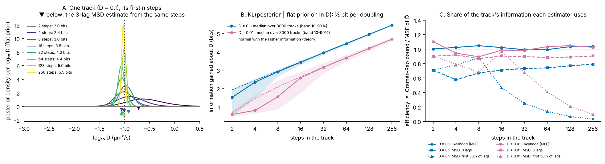
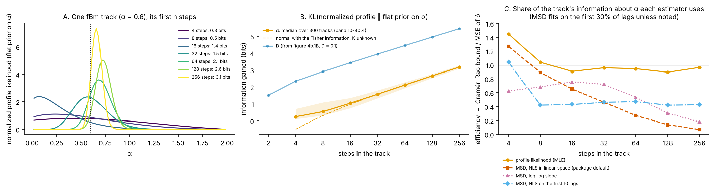

# 04b · What each step teaches: information per track, against the MSD

*diffusionkit main. Source: `diffusionkit/gridpost/posterior.py` (`track_loglik`, `log_posterior`, `flat`, `information_bits`), `gridpost/likelihood.py` (`brownian_loglik_batch`, `motion_covariance`, `localization_covariance`), `fbmpost/likelihood.py` (`whiten_batch`), `fbmpost/profile.py` (`profile_K`), `fbmpost/covariance.py` (`fgn_motion_covariance`), and for the MSD `classic/analysis.py` (`compute_msd`) and `classic/estimators.py` (`fit_brownian_msd`, `fit_anomalous_msd`, `fit_loglog_msd`). Figures: `scripts/fig_04b_information.py`.*

Explainers 03 and 04 showed what gridpost and fbmpost compute for one track. This one asks how much a track actually tells us, and how much of that the classic MSD fit throws away. The tool is to follow one track as its steps come in, watch its flat-prior posterior narrow, and count what it has learned in bits.

The simulations here have localization noise (σ = 30 nm, Δt = 35 ms) and **no exposure blur**, because the MSD estimators refuse blurred tracks (explainer 07). With blur, the likelihood handles it and the MSD cannot, so these results are the MSD's best case.

---

## 1. The posterior with a flat prior is the normalised likelihood

Put a flat prior on the parameter over a range of width W: ln D on gridpost's grid (10⁻⁵ to 10 µm²/s, so W = 13.8 nats), or α on fbmpost's grid (0.02 to 1.98, so W ≈ 2). The posterior is then just the likelihood, normalised over that range:

$$
p(\theta \mid \text{track}) = \frac{L(\theta)}{\int_W L(\theta')\,d\theta'} .
$$

For D this is exactly what gridpost reports. For α the code profiles out the amplitude K rather than integrating it (explainer 04 §4 explains why), so "the posterior" for α here means the profile likelihood normalised on the α grid.

As steps come in, the posterior narrows (figures 4b.1A and 4b.2A). How fast it narrows is set by the **Fisher information** I(θ), the expected curvature of the log-likelihood. For a long track the posterior is close to a normal distribution with SD 1/√I, and I grows in proportion to the number of steps n.

- **For ln D**, without noise each displacement carries ½ unit of information per axis, so a 2-D track of n steps has I = n and SD(ln D) = 1/√n. Localization noise lowers the information each step carries. The code's covariance Σ(D) = DA + B gives I = ½ Σ_axes tr[(Σ⁻¹ DA)²].
- **For α**, the information is computed the same way from fbmpost's covariance KC_α + B, with ln K unknown. That subtracts the part of α's information that is shared with K: I_α − I_αK² / I_KK.

## 2. Information gained, in bits

What has the track taught us? The standard measure is the Kullback–Leibler divergence of the posterior from the prior (Lindley 1956):

$$
\mathrm{KL}(p \,\|\, \pi) = \int p(\theta)\,\log_2 \frac{p(\theta)}{\pi(\theta)}\,d\theta \quad\text{bits}.
$$

It is 0 when the data leave the prior unchanged. Each bit is worth about halving the range of plausible values. gridpost reports it for every track as `information_bits`.

**Why not the cross entropy?** The cross entropy of the posterior against the prior, −∫ p log π, is log₂ W for a flat prior whatever the posterior is, so it cannot track learning. The KL divergence is that cross entropy minus the posterior's own entropy: KL = log₂ W − H(p). The information gained is how far the posterior's entropy has fallen below the prior's.

For a normal posterior with SD s, H(p) = log₂(s√(2πe)), so

$$
\mathrm{KL} \approx \log_2 \frac{W}{s\sqrt{2\pi e}} = \log_2 W + \tfrac12\log_2 I - \tfrac12\log_2(2\pi e).
$$

Two things follow.

- **Each doubling of the track adds ½ bit.** I is proportional to n, so KL rises by ½ log₂ 2 = ½ bit per doubling, whatever the parameter and whatever the method, as long as the method uses all the information.
- **The absolute number of bits depends on the prior's range.** A wider W adds bits without the data doing anything. Bits are comparable between tracks on the same grid, and the *slope* is comparable between any two parameters, but the height of the curve is not.

*Figure 4b.1. Brownian D, σ = 30 nm, Δt = 35 ms, no blur. A: one track with D = 0.1 µm²/s; its flat-prior posterior from the first n steps (`track_loglik`), with each curve's information in bits. The triangles below are the 3-lag MSD estimates of D from the same steps: points, with no width. B: information gained per track (`information_bits`), median and 10–90% band over 3000 tracks, at D = 0.1 (above the localization floor, 0.026) and at D = 0.01 (below it). Dashed: the normal approximation with the exact Fisher information. C: efficiency, the Cramér–Rao bound divided by each estimator's mean squared error, over the same 3000 tracks per point.*

**What figure 4b.1B shows.**

| Steps | 2 | 4 | 8 | 16 | 32 | 64 | 128 | 256 |
|---|---|---|---|---|---|---|---|---|
| SD of ln D at the bound, D = 0.1 | 0.88 | 0.61 | 0.43 | 0.31 | 0.22 | 0.15 | 0.11 | 0.076 |
| Bits gained, D = 0.1 (median) | 1.5 | 2.4 | 2.9 | 3.4 | 3.9 | 4.5 | 5.0 | 5.5 |
| Bits gained, D = 0.01 (median) | 0.6 | 0.8 | 1.6 | 2.6 | 3.2 | 3.7 | 4.2 | 4.7 |

- From about 8 steps on (16 below the floor), the bits follow the normal approximation to within 0.1 bit and climb by 0.50 bits per doubling.
- Shorter tracks gain less than the approximation says, because their posteriors are skewed with a long tail toward small D, not normal.
- Below the floor every step carries less: the D = 0.01 curve sits about 0.8 bits under the D = 0.1 curve at long lengths. 0.8 bits is a factor of 2^(2 × 0.8) ≈ 3 in Fisher information, so a step there is worth about a third of one above the floor.

## 3. How much of it does an estimator use?

A point estimate cannot be given bits directly, but its spread can be compared with the best possible. The **Cramér–Rao bound** says no unbiased estimator can have a variance below 1/I (Rao 1945; Cramér 1946). The maximum-likelihood estimate reaches it for long tracks. So

$$
\eta = \frac{1/I}{\mathrm{MSE}(\hat\theta)}
$$

is the share of the track's information an estimator uses. An estimator with efficiency η is as good as the likelihood would be with ηn steps. In bits, it gives up ½ log₂(1/η): 0.26 bits at η = 0.7, and 2.5 bits at η = 0.03.

**D (figure 4b.1C).**

| Steps | 2 | 4 | 8 | 16 | 32 | 64 | 128 | 256 |
|---|---|---|---|---|---|---|---|---|
| D = 0.1: likelihood (MLE) | 1.00 | 1.02 | 1.05 | 1.02 | 0.99 | 0.99 | 1.03 | 1.03 |
| D = 0.1: MSD, 3 lags | 0.71 | 0.58 | 0.67 | 0.71 | 0.73 | 0.74 | 0.77 | 0.79 |
| D = 0.1: MSD, first 30% of lags | 0.71 | 0.78 | 0.88 | 0.47 | 0.25 | 0.14 | 0.07 | 0.03 |
| D = 0.01: likelihood (MLE) | 1.10 | 0.94 | 0.89 | 0.98 | 0.98 | 1.03 | 1.05 | 1.03 |
| D = 0.01: MSD, 3 lags | 0.90 | 0.92 | 0.87 | 0.90 | 0.90 | 0.88 | 0.89 | 0.90 |
| D = 0.01: MSD, first 30% of lags | 0.90 | 0.79 | 0.68 | 0.96 | 0.68 | 0.41 | 0.21 | 0.10 |
| D = 0.01: MSD estimates ≤ 0 | 40% | 23% | 9% | 1% | 0 | 0 | 0 | 0 |

With 3000 tracks per point, each efficiency carries a Monte Carlo error of a few percent, which is why the MLE wanders a little either side of 1.

- **The likelihood is efficient at every length and on both sides of the floor**, with nothing to tune.
- **The MSD's D depends on how many lags it fits, and the best number depends on the noise.** With 3 lags (the package default) it uses 58–79% of the information above the floor and about 90% below it. That matches Michalet (2010): when noise dominates, the first two or three lags are nearly optimal, and when motion dominates more lags would help. The number that would be optimal depends on σ²/(DΔt), which is the very thing being estimated.
- **The common "first 30% of the curve" rule wastes most of a long track.** At 256 steps it uses 3% of the information above the floor. That is like keeping 8 of the 256 steps, or 2.5 bits lost. Long lags rest on heavily overlapping displacements, so the extra MSD points are strongly correlated with each other and add noise instead of information.
- **At short lengths below the floor, the MSD's D is often unusable.** 40% of 2-step and 23% of 4-step estimates are zero or negative.

So for D, a well-tuned MSD can come within about 10% of the bound below the floor. The likelihood's advantages are that it gets there without tuning, handles blur, never goes negative, and comes with its posterior and its bits.

## 4. α: the same picture, and a bigger gap

*Figure 4b.2. fBm with α = 0.6, D_ref = 0.1 µm²/s at τ_ref = 0.1 s, σ = 30 nm, no blur. A: one track's profile likelihood (`whiten_batch`, `profile_K`), normalised on the α grid, from its first n steps, with its information in bits. B: information gained about α, median and 10–90% band over 300 tracks, with the normal approximation from the exact Fisher information with K unknown, and figure 4b.1B's D = 0.1 curve for comparison. C: efficiency of the profile MLE and of three MSD fits: nonlinear least squares in linear space (`fit_anomalous_msd`, the package's per-track default), the log-log slope (`fit_loglog_msd`), both on the first 30% of lags, and nonlinear least squares on the first 10 lags.*

**Bits.**

| Steps | 4 | 8 | 16 | 32 | 64 | 128 | 256 |
|---|---|---|---|---|---|---|---|
| SD of α at the bound, K unknown | 0.68 | 0.39 | 0.24 | 0.16 | 0.11 | 0.076 | 0.053 |
| Bits gained about α (median) | 0.2 | 0.6 | 1.0 | 1.6 | 2.1 | 2.7 | 3.2 |

From 32 steps on, the bits about α follow the normal approximation to within 0.02 bit and climb by the same ½ bit per doubling as D. The curve sits about 2.3 bits below D's, but that is almost all the prior's range: log₂(13.8 / 1.98) = 2.8 bits more room for ln D than for α. On equal terms α is learned no slower than ln D. Here its SD at the bound (0.053 at 256 steps) is a little *smaller* than ln D's (0.076). What makes α feel slow is the precision we ask of it: telling α = 0.7 from 1.0 is a difference of 0.3, while for D we usually care about a factor of 2, a difference of 0.7 in ln D.

**Efficiency.**

| Steps | 4 | 8 | 16 | 32 | 64 | 128 | 256 |
|---|---|---|---|---|---|---|---|
| Profile likelihood (MLE) | (1.45) | (1.04) | 0.91 | 0.96 | 0.95 | 0.90 | 0.97 |
| MSD, NLS, first 30% of lags | (1.27) | 0.89 | 0.65 | 0.46 | 0.27 | 0.14 | 0.07 |
| MSD, log-log slope, first 30% of lags | 0.63 | 0.68 | 0.76 | 0.72 | 0.53 | 0.31 | 0.18 |
| MSD, NLS, first 10 lags | (1.04) | 0.42 | 0.43 | 0.46 | 0.47 | 0.42 | 0.43 |

Values in brackets are not efficiencies: the bound holds only for unbiased estimators, and at 4 and 8 steps the estimates are pinned to the ends of the allowed range (35% and 13% of the MLEs sit at the grid's edge). That truncation makes their spread smaller than the bound, without making them better. From 16 steps on the comparison is fair.

- **The profile likelihood uses 90–97% of the information about α** from 16 steps on. Profiling K costs a little against the full bound.
- **From 16 steps on, no MSD fit tried does better than 76%**, and most use 40–50% or less. The best MSD choice still needs about twice as many steps to match the likelihood. With the 30% rule on a 256-step track, NLS uses 7% of the information, which is like keeping 18 of the 256 steps.
- The reason is the one in explainer 07: α is read from how the MSD bends across lags, and the long-lag MSD points are both noisy and correlated, which least squares treats as independent.

## 5. What this means in practice

- **Report the posterior, or its bits, rather than a point.** A track's information grows only as ½ log₂ n, so most tracks in a movie end up with a few bits about D and fewer about α. The posterior says how many each track has, and the MSD says nothing.
- **The gap is largest for α and for long tracks.** For D near or below the floor, a 3-lag MSD is close to the bound. For α the MSD gives up about half of the information at its best.
- **More steps buy little; more tracks buy a lot.** Doubling a track adds ½ bit. Pooling tracks that share a parameter adds their information directly: the population models (explainer 05) and the shared α of explainer 04 §5 are where precision comes from.

## Standard or new?

| Piece | Status | Reference to check |
|---|---|---|
| Fisher information and the Cramér–Rao bound | Standard | Rao 1945, *Bull. Calcutta Math. Soc.* 37:81; Cramér 1946, *Mathematical Methods of Statistics* |
| KL divergence from the prior as information gained | Standard | Lindley 1956, *Ann. Math. Stat.* 27:986; Cover & Thomas, *Elements of Information Theory* |
| The Brownian likelihood with noise reaches the bound; the MSD's optimal number of lags depends on the noise | Known | Michalet 2010, *Phys. Rev. E* 82:041914; Michalet & Berglund 2012, *Phys. Rev. E* 85:061916; compare Vestergaard, Blainey & Flyvbjerg 2014, *Phys. Rev. E* 89:022726 (CVE) |
| Per-track information in bits, reported for every track | Uncommon in SPT as far as I know | — |
| Side-by-side information curves for ln D and α, with α's efficiency for MSD fits against the bound | I have not seen it laid out this way | Compare Lysy et al. 2016, *JASA* 111:1413 (fBm likelihood) |

(Citations from memory: please check.)
