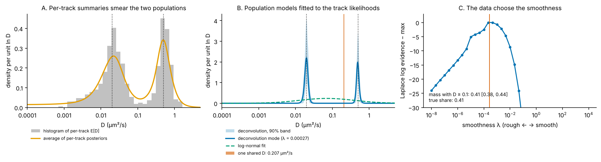

# 05 · From tracks to a population: the distribution of D

*diffusionkit main. Source: `diffusionkit/gridpost/lognormal.py` (`fit_shared_D`, `fit_lognormal`, `hat_weights`), `gridpost/deconvolve.py` (`deconvolve`, `deconvolve_2d`, `_LogG`), `gridpost/composition.py` (`by_track_length`). Entry points: `shared_D_tracks`, `lognormal_tracks`, `deconvolve_tracks` on `analyze_tracks(..., keep_likelihoods=True)`.*

Explainer 03 gives each track a posterior over D. The question a figure in a paper usually answers is about the *population*: how is D distributed across all the particles in a condition? It is tempting to histogram the per-track estimates, or to average the per-track posteriors. Both are wrong in a way that matters, and figure 5.1A shows how.

- **A histogram of per-track estimates** mixes the spread of true D values with each track's measurement noise. Short tracks scatter widely, so two narrow populations come out as two broad humps.
- **An average of per-track posteriors** has the same problem. It also counts the prior once per track, and it is "the likelihood of nothing": it adds the tracks' posteriors, while independent tracks multiply, so no model of the tracks produces it.

The right object is a **hierarchical model**. The population is a density g(u) over u = ln D. Each track's D is drawn from g, and each track's data depend on its own D through the likelihood Lᵢ(u) from explainer 03. Integrating out each track's own D,

$$
\ell(g) = \sum_i \log \int L_i(u)\, g(u)\, du .
$$

The order matters. Each track's own D is unknown, so it is averaged out *inside* the integral (the law of total probability). The tracks are independent, so their probabilities multiply, which is the sum of logs *outside*. Putting the log inside instead, Σᵢ log Lᵢ(u), assumes every track has the same u. That is the shared-D model of §1 below.

This uses each track's *likelihood*, not its posterior, so no prior is counted per track. A short, uninformative track has a flat Lᵢ and leaves ℓ(g) unchanged. It cannot drag the population toward the prior the way it drags a histogram of medians.

diffusionkit offers three choices of g.

*Figure 5.1. 600 simulated tracks of 4–30 frames: 60% at D = 0.02 µm²/s and 40% at D = 0.5 µm²/s (dotted lines). A: a histogram of per-track E[D] and the average of per-track posteriors, both smeared. B: the three population models fitted to the same likelihoods with the real `shared_D_tracks`, `lognormal_tracks` and `deconvolve_tracks`. C: the evidence curve that chose the deconvolution's smoothness.*

---

## 1. One shared D (complete pooling)

g = δ(u − u₀): every track has the same D. Then ℓ = Σᵢ log Lᵢ(u₀), the summed log-likelihood (`fit_shared_D`). The sum is smooth near its peak, so it is read off a cubic spline at 64 points per grid cell, which resolves it below the grid step.

Its interval shrinks as 1/√n however different the tracks are, and long tracks dominate it. In figure 5.1B it lands at 0.207 µm²/s [0.202, 0.212]. That is between the two populations, and much more confident than it has any right to be. It answers "if all tracks shared one D, what would it be?", which is only useful when that assumption holds.

## 2. A log-normal population

ln D ~ N(μ, σ) across tracks, truncated to the grid (`fit_lognormal`). σ = 0 is complete pooling, so σ's posterior says whether one D describes the tracks.

The integral ∫Lᵢ(u)N(u; μ, σ)du is exact: Lᵢ is taken as linear between grid points, a sum of hat functions, and the integral of a hat against a normal has a closed form in Φ and φ (`hat_weights`). It stays correct at σ = 0, where it becomes linear interpolation. The posterior over (μ, σ) is evaluated on a 61 × 41 grid with flat priors (μ over the D grid, σ on [0, 3]). The grid zooms in on where the posterior lives until its cells resolve it.

In figure 5.1B the fit gives median D = 0.070 µm²/s and σ = 1.72 in ln D. A bimodal population forced into one log-normal gives a broad hump centred between the modes. The fit is honest about the spread but blind to the shape.

## 3. A smooth density of any shape (`deconvolve`)

g is a density on the grid, parametrised as g = softmax(η) (so it is positive and sums to 1), with a Gaussian smoothness prior on η = log g:

$$
\log p(\eta\mid\lambda) = -\frac\lambda2\int \eta''(u)^2\,du + \text{const} ,
$$

discretised as a second-difference penalty. This is a **logistic Gaussian process**, or log-spline, density estimate. The penalty ignores constants and linear tilts of log g; the tilt gets a negligible proper prior (`EPS`) so the evidence is defined.

**Choosing λ: the evidence.** λ sets how smooth g must be. Too large, and two modes blur into one; too small, and g follows noise. The code computes the Laplace approximation to the marginal likelihood p(tracks | λ) over a grid of 37 values from 10⁴ to 10⁻⁸ (`LAM_GRID`), warm-starting each fit from the smoother one. It then refines the maximum in log λ. In figure 5.1C the evidence peaks at λ ≈ 2.7 × 10⁻⁴, well inside the grid.

**Uncertainty: Laplace-preconditioned HMC.** The band is made from posterior draws of g, with λ integrated out by sending chains to each λ in proportion to its evidence (50 chains in total). The draws come from Hamiltonian Monte Carlo, not from the Laplace Gaussian itself, and the docstring gives the reason. Where the data rule a grid cell out, its mass at the mode is about 0, so the local curvature is about 0, but the true posterior has a cliff. Gaussian draws would cross the cliff and put mass in empty cells. HMC uses the Laplace Hessian's Cholesky factor only to precondition its momenta.

I checked the gradient and Hessian of ℓ(softmax η) in `_LogG.local` by hand. The gradient is r − n·g − Qη, with r the column sums of the responsibilities. The negative Hessian is RᵀR − diag(r) + n(diag g − ggᵀ) + Q.

**Result.** In figure 5.1B the deconvolution recovers two narrow modes at the right places. Its draws put mass 0.41 [0.38, 0.44] (90%) above D = 0.1 µm²/s; the true share is 0.41. The docstring states two limits, and both are worth keeping in mind:

- **A mode narrower than one track can resolve comes out as wide as the smoothness prior allows.** Read a peak's width as resolution-limited.
- **Below the localization floor, tracks cannot tell D values apart**, so the band widens there and a mode's location is under-covered.

## 4. Splitting by track length (`by_track_length`)

Track length is observed, and it is tied to D: fast particles leave the focal plane quickly and make short tracks. `by_track_length` deconvolves each length group separately (lower edges 3, 5, 10, 20 frames) and stacks the groups by their share of tracks or detections. The stack shows which tracks each part of the population comes from. Given explainer 02's truncation, this is also the natural diagnostic for whether fast particles are under-represented in long tracks.

## Standard or new?

| Piece | Status | Reference to check |
|---|---|---|
| Hierarchical model with per-track likelihoods (not posteriors) | Standard | Efron 2016, *Biometrika* 103:1 ("g-modeling") |
| Shared D by summed log-likelihood | Standard | — |
| Log-normal population with an exact hat-function integral | Standard model; the exact integral is a nice touch | — |
| Nonparametric g | Standard: NPMLE | Kiefer & Wolfowitz 1956, *Ann. Math. Stat.* 27:887; Koenker & Mizera 2014, *JASA* 109:674 |
| Logistic-Gaussian-process (log-spline) density with a 2nd-difference penalty | Standard density estimation | Leonard 1978, *JRSS B* 40:113; Eilers & Marx 1996, *Stat. Sci.* 11:89 |
| Smoothness by Laplace evidence | Standard empirical Bayes | MacKay 1992 |
| Laplace-preconditioned HMC with λ mixed by evidence | Appears new for this problem | — |
| Population of D for SPT | Related work exists | Heckert et al. 2022, *eLife* 11:e70169 (saspt, state arrays) |
| Splitting the population by track length | Appears new as a packaged diagnostic | — |
