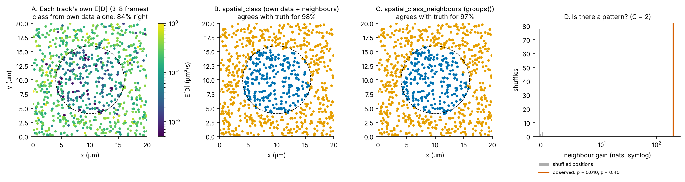
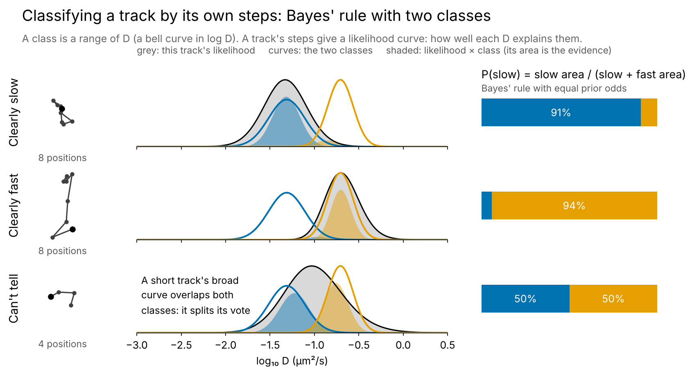
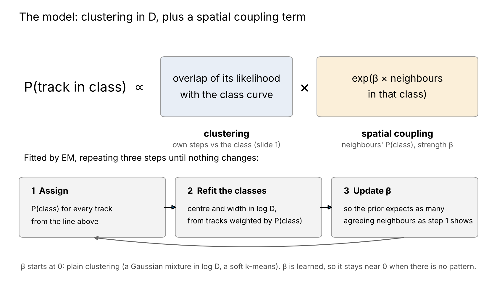
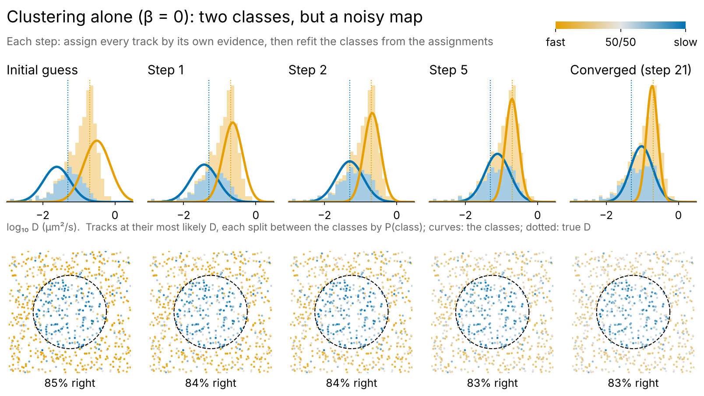
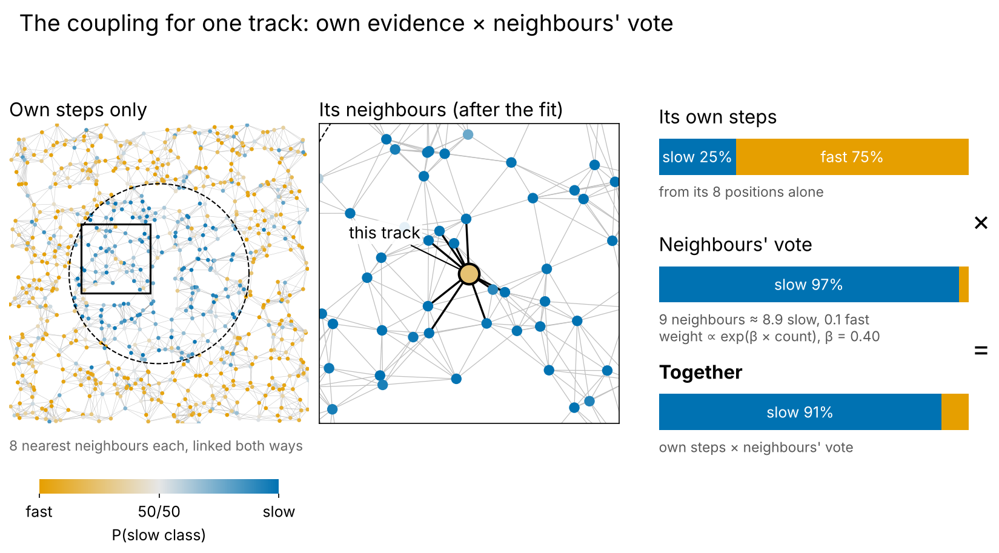
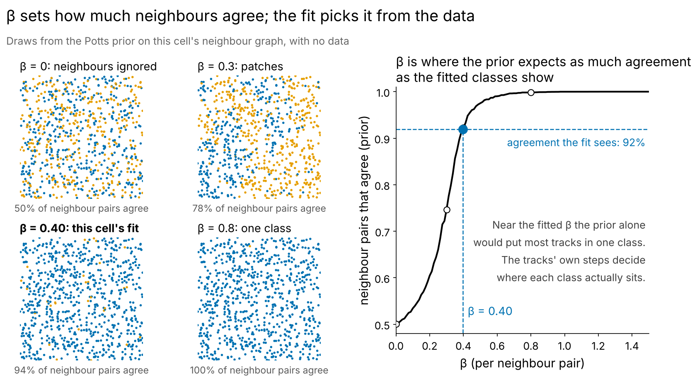
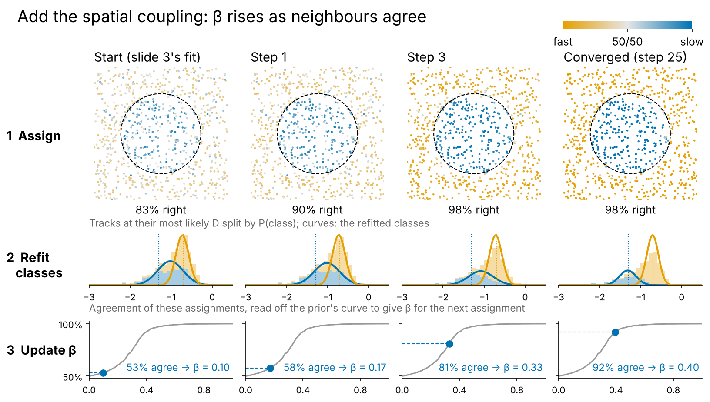
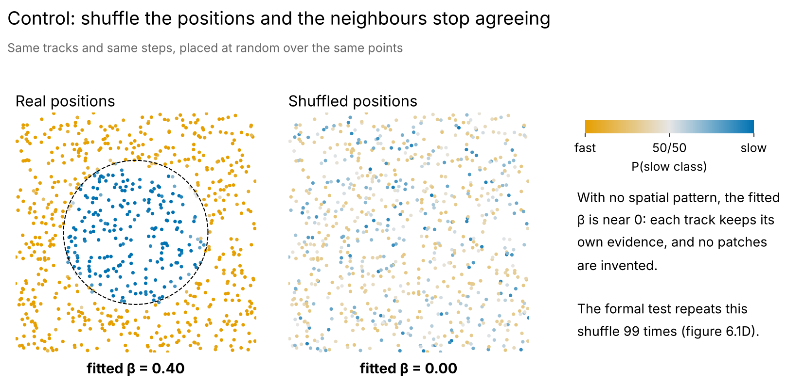
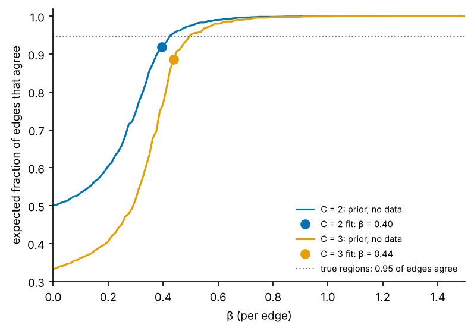

# 06 · Where in the cell does D differ? Spatial classes

*diffusionkit main, with the spatial classes from [PR #6](https://github.com/delnatan/diffusionkit/pull/6) (it superseded PR #4). Source: `diffusionkit/spatial/potts.py` (`graph`, `fit`, `agreement_table`, `beta_for`, `splits`, `PottsFit.score`, `neighbour_q`), `spatial/workflow.py` (`analyze_likelihoods`, `_selection`), `spatial/data.py` (`SpatialAnalysis.groups`, `ShuffleNull`). Entry point: `spatial.analyze(gridpost_result, positions)`.*

Suppose D is lower inside a condensate than in the cytoplasm around it. With short tracks, each track's own D is too noisy to show the boundary (figure 6.1A). Its *neighbours*, though, are mostly in the same place. If D is spatially organised, a track's neighbours carry information about it. If it is not, they carry none, and we should be able to tell the difference.

spatial does this with a **hidden Potts model** on the graph of nearby tracks.

*Figure 6.1. 800 simulated tracks of 3–8 frames. D = 0.05 µm²/s inside a 6 µm disc (dashed) and 0.2 outside, with the real `gridpost.analyze_tracks` and `spatial.analyze` (99 shuffles). A: each track's own E[D]. Classifying by a track's own data alone is right for 84% of tracks. B: the class from a track's own data and its neighbours, 98% right. C: the class from its neighbours alone, 97% right; this is what `groups()` uses. D: the neighbour gain against 99 shuffles of the positions. The real arrangement beats every shuffle (p = 0.01, the smallest 99 shuffles can give, β = 0.40). The same tracks with shuffled positions (the control) choose one class, so there is no pattern to test.*

---

## 0. The idea in seven pictures

In one line: **clustering of the tracks in log D, plus a spatial coupling term.** Each track's class probability is

P(track in class c) ∝ (overlap of its likelihood with class c's curve) × exp(β × number of its neighbours in class c).

The first factor is ordinary Bayesian clustering, a Gaussian mixture in log D (a soft k-means whose data points are likelihood curves). The second is the Potts coupling: neighbours pull a track toward their class, with a strength β learned from the data. β starts at 0, so the fit begins as plain clustering, and it stays near 0 when the arrangement shows no pattern. The coupling encourages contiguous regions; it does not force them, because a track with strong evidence of its own keeps its class.

The same toy cell, fitted with two classes (`scripts/fig_06_potts_explained.py`; slide-sized, in presentation order).

*Figure 6.0a. What "classifying a track by its own steps" means. A class is a range of D: a bell curve in log D. A track's steps give a likelihood curve over D (grey), which says how well each D explains those steps: narrow for a long track, broad for a short one. The track's evidence for a class is the overlap of the two curves, the area under likelihood × class (shaded). With equal prior odds, Bayes' rule gives P(slow) = slow area / (slow area + fast area). A clear 8-position track lands at 91% or 94%; a 4-position track whose broad curve covers both classes splits 50/50.*

*Figure 6.0b. The model on one slide: the clustering factor times the spatial coupling factor, fitted by EM. One pass: (1) assign every track a P(class) from that product; (2) refit each class's centre and width in log D from all tracks weighted by P(class); (3) set β so the prior expects as many agreeing neighbour pairs as the assignments show. Repeat until nothing changes.*

*Figure 6.0c. EM with β held at 0 is an ordinary Bayesian mixture model: only steps 1 and 2. From a rough initial guess, the classes move and narrow until they stop changing (step 21). The fast class settles on the true D; the slow class sits too high, because it also absorbs ambiguous fast tracks. In space the assignments stay salt-and-pepper, about 83% right, slightly worse than the rough initial guess at 85%, since the converged classes split the ambiguous tracks differently. This converged fit is where the neighbour fit starts (the package also tries splits of the one-class fit and keeps the best; §2).*

*Figure 6.0d. Step 1 with neighbours, for one track. Its own 8 positions point the wrong way (25% slow). Its 9 neighbours on the graph (each track's 8 nearest, linked both ways) are almost all slow, and they vote with weight exp(β × count), 97% slow. Multiplying the two and renormalizing gives 91% slow. A track with strong evidence of its own keeps it; the vote mostly decides tracks whose own data are ambiguous.*

*Figure 6.0e. β is how strongly neighbours agree. Left: single draws from the Potts prior on this cell's graph, with no data. At β = 0 labels are independent, at 0.3 they form patches, and past about 0.45 one class takes over. Right: the fraction of agreeing neighbour pairs the prior expects at each β. Step 3 picks the β whose prior agreement matches the agreement among the current assignments (92% at convergence, so β = 0.40). At that β the prior alone would put most tracks in one class; the tracks' own steps are what keep the disc and its surroundings apart.*

*Figure 6.0f. The full loop, from figure 6.0c's fit. Each column is one pass. Row 1: the assignments, own evidence × the neighbours' vote. Row 2: the classes refitted from them. Row 3: the agreement of those assignments read off the prior's curve, which gives β for the next pass. Agreement and β climb together (53% → 0.10, 58% → 0.17, 81% → 0.33, 92% → 0.40), the slow class moves down to the true D, and 98% of tracks end on the right side of the boundary.*

*Figure 6.0g. The same tracks placed at random over the same points. The neighbours no longer agree, the fit sets β = 0, and each track keeps its own evidence, so no patches are invented. The formal test (§3) repeats this shuffle 99 times and asks whether the real arrangement predicts tracks from their neighbours better than every shuffle does.*

## 1. The model

**Classes.** C classes, each a normal density in ln D with mean μ_c and SD σ_c on the grid. An extra `MIN_SD` = 0.1 is added in quadrature to σ_c, so a class never collapses onto one grid cell. Track i's evidence for class c is its gridpost likelihood averaged over that class:

$$
e_{ic} = \sum_u L_i(u)\,p_c(u).
$$

**Graph.** Each track lists its k = 8 nearest neighbours by centroid, and i ~ j if either lists the other (`graph`). The graph is symmetric, so each track ends up with about 9.3 neighbours on average.

**Potts prior.** The labels z have the joint prior

$$
P(z\mid\beta) = \frac{\exp\big(\beta\,S(z)\big)}{Z(\beta)},\qquad S(z) = \#\{\text{edges } i\sim j : z_i = z_j\},
$$

so a track's class given its neighbours' is

$$
P(z_i = c \mid \text{neighbours}) \propto \exp\big(\beta\, n_{ic}\big),
$$

where n_ic is the number of i's neighbours in class c. β is per edge. There are **no class weights**: at β = 0 this is a mixture with equal weights, and β > 0 means neighbouring tracks tend to share a class. Z(β) is the normalising constant, a sum over all Cⁿ labellings.

## 2. Fitting: mean-field EM with an exact β step

Exact inference in a Potts model is intractable, so `potts.fit` uses the mean-field approximation for the labels (Zhang 1992; Celeux, Forbes & Peyrard 2003). Each iteration does three things:

1. **E-step.** Replace each neighbour's label by its current class probabilities q_j and iterate q_ic ∝ e_ic exp(β Σ_{j∈N(i)} q_jc) for `SWEEPS` = 5 sweeps.
2. **M-step for the classes.** Refit each class's mean and SD from the tracks' grid posteriors weighted by q.
3. **M-step for β.** The expected complete-data log-likelihood in β is β E_q[S] − log Z(β). Because the prior is an exponential family in β, its maximum is where

$$
\mathbb{E}_\beta[S] = \mathbb{E}_q[S]:
$$

the prior's expected number of agreeing edges equals the fit's. The right side is the mean over edges of Σ_c q_ic q_jc (`edge_agreement`). The left side depends only on the graph and C, not on the data, so `agreement_table` tabulates it once per movie: Swendsen–Wang sampling of the prior with no data on a grid of β from 0 to 1.5 (121 points, 50 sweeps discarded and 100 averaged at each). Each M-step then reads β off the table by interpolation (`beta_for`). β starts at 0.

The −log Z(β) term is what holds β back. If β grew past the fit's own agreement, the prior would expect more agreeing edges than the posterior shows, and the M-step would pull β down. An approximation that drops log Z (pseudo-likelihood and its relatives) has no such brake, and that is how the old code's β ran away (§5).

*Figure 6.2. The agreement table for an 800-track graph like figure 6.1's, for C = 2 and 3: the prior's expected fraction of agreeing edges against β. It rises steeply between β ≈ 0.25 and 0.45, the Potts transition on this graph, and is close to 1 by β = 0.7. Each fit's β is where the curve reaches the fit's own agreement (dots: the C = 2 and C = 3 fits to figure 6.1's movie). Dotted: the fraction of edges whose ends lie in the same true region.*

**Is the mean field good enough here?** It enters in one place: E_q[S] is computed from mean-field q rather than sampled. A test samples the same posterior (the fit's classes and β) by Gibbs sampling, reads its edge agreement, and checks that the table gives the fit's β back. On the test movie they agree to within 0.03 in β (`test_mean_field_agreement_matches_gibbs`). In the prototype, a full Gibbs E-step and the mean-field E-step gave β within 0.01 of each other.

**Starts.** The C-class fit is run from the plain mixture (β = 0, equal weights) and from the C − 1 fit with each of its classes split in two, half a width either side of its centre, each half with width σ/√2 (`splits`, the split move of split-and-merge EM, Ueda et al. 2000). The fit with the best neighbour-predictive score (§3) is kept. Without the splits, the plain mixture's equal weights can split one large class and merge two small ones, and on three-region cells that picked 2 classes on 5 of 7 movies (§5).

## 3. How many classes, and is there a pattern?

**The score.** A fit's **neighbour-predictive likelihood** is Σᵢ log Σ_c P(c | neighbours of i)·e_ic (`PottsFit.score`). It scores how well a track's neighbours, *without its own data*, predict its data, so it rewards a pattern only if the pattern predicts tracks it has not seen.

**Number of classes** (`_selection`). The model is fitted for C = 1…`max_classes`. The suggested C is the last one whose gain in neighbour-predictive score over C − 1 is at least `gain_per_track` = 0.02 nats per track, counting up and stopping at the first that falls short.

**Is there a pattern at all?** The test uses the **neighbour gain**: the fit's neighbour-predictive score minus the plain mixture's (β = 0), which no arrangement changes. The null comes from shuffling the positions, which keeps every track's data and destroys only the arrangement (`ShuffleNull`). A shuffle is a permutation of the tracks over the same points, so the graph is the same one with its nodes relabelled, and the agreement table serves every shuffle. Each shuffle repeats the observed fit from the observed fit's start, and p = (1 + shuffles with gain ≥ observed)/(1 + n_shuffles). β is identified now and sits near 0 when there is no pattern (0.00–0.05 on the controls below), but the gain is still the statistic, since it is in nats and does not depend on the graph's transition point.

**Grouping without circularity** (`groups`). Per-class populations (explainer 05) are computed from tracks assigned by their **neighbours alone** (`spatial_class_neighbours`). Assigning by a track's own data would select tracks on the very D the population then reports, which biases the classes apart.

## 4. Results on simulated cells

Two kinds of simulated cells, 7 movies each, 800 tracks of 3–8 frames in a 20 µm square, and 7 controls of each (the same tracks with shuffled positions). 19 shuffles each, so p = 0.05 is the smallest possible.

- **Two regions:** D = 0.05 inside a 6 µm disc, 0.2 outside.
- **Three regions:** D = 0.03 in a disc at (6, 6), 0.1 in a disc at (14, 14), both of radius 4.5 µm, and 0.35 elsewhere.

| | Two regions | Three regions |
|---|---|---|
| C chosen (cells) | 2 on 7/7 | 3 on 7/7 |
| Tracks classified correctly | 98–99.5% | 98–99% |
| β | 0.37–0.40 | 0.42–0.44 |
| Shuffle p (cells) | 0.05 on 7/7 | 0.05 on 7/7 |
| Gain for one more class | ≤ 0.008 nats/track | ≤ 0.005 nats/track |
| Controls: C chosen | 1 on 7/7 | 2 on 7/7 (a plain two-class mixture) |
| Controls: shuffle p | none tested (C = 1) | 0.15–0.85; none flagged |
| Controls: β | 0 | 0.00–0.05 |

The three-region controls choose 2 classes because the tracks' D values really are a mixture of fast and slow. That needs no space, and the shuffle test correctly says there is no pattern.

The fitted β of about 0.4 sits just past the steep part of the table (figure 6.2), where the prior's agreement matches the pattern's. In figure 6.1's movie 95% of edges have both ends in the same true region; the fit's own agreement is 0.92, a little lower because tracks near the edge stay uncertain. That is what a real domain should look like. The old code's β was 30 (§5).

For comparison, on the three-region cells the multi-start fix of PR #4 chose C = 4, 3, 4, 2, 3, 2, 4 (84–98% correct).

## 5. How the old fit broke, and what changed

The old code (on main before PR #6) had class weights w, a directed kNN graph, and the conditional P(z_i = c | neighbours) ∝ w_c exp(β m̄_ic), with m̄_ic the *fraction* of neighbours in class c. β was learned by maximising the neighbour-predictive score and w by the mean-field pseudo-likelihood. Neither objective contains log Z(β).

On a two-region movie (seed 6) that procedure drove β to its cap (`BETA_MAX` = 30) and w to 0.999 / 0.001, and the run suggested **3 classes**, the third a made-up domain on the disc's edge:

| Fit (old code) | β | Neighbour-predictive score |
|---|---|---|
| C = 2, learned from the plain mixture | 30 (cap), w = 0.999 / 0.001 | −4005.7 |
| C = 2, learned from a fit at β = 4 or 8 | 7.4 | **−3949.2** |
| C = 3 | 10.0 | −3969.5 |

PR #4 patched this by restarting a capped fit from fixed-β starts and keeping the best score. That fixed seed 6 but not the cause: on the three-region cells it chose the wrong C on 5 of 7.

**The cause is the Potts phase transition, a known property.** Above a critical β the prior prefers almost every node in one class, and the mean-field E-step has a self-consistent "frozen" solution where every track takes its neighbours' majority class and the data are outvoted. In the old parametrisation, with no data, the even split is a stable mean-field fixed point only while β < C (linearising the softmax gives a gain of β/C on any zero-sum perturbation; my derivation, not from a reference). The cap of 30 sat far above that. The setting here makes the transition bite harder than in image segmentation: a pixel usually carries strong data, while a 3–8 frame track carries little.

The literature handles it in two ways: fix or bound β below the critical value (most image segmentation; Green & Richardson 2002 for disease mapping), or keep log Z(β) in the inference, by auxiliary-variable and exchange samplers (Møller et al. 2006; Murray, Ghahramani & MacKay 2006), variational Bayes (McGrory et al. 2009), or a pre-computed map from β to the sufficient statistic (Moores et al. 2015). PR #6 takes the last route inside EM, where only E_β[S], not Z(β) itself, is needed.

**What changed in PR #6, and why each piece:**

- **No class weights.** Under a Potts prior, w and β trade off along a flat ridge, so neither was identified, and w was never a class share (fits put it anywhere from 0.01 / 0.99 to 0.47 / 0.53 when the true share was 0.28 / 0.72). Dropping it leaves β alone and identified.
- **β by its exact M-step**, so log Z(β) is in the objective and β cannot run past the fit's own agreement (§2).
- **A symmetric graph**, so the conditionals come from one joint distribution and the Potts theory above applies. On the old directed graph they need not.
- **Counts, not fractions**, in the conditional: the natural form of S(z) on a graph with uneven degrees.
- **Split starts**, because without weights the plain mixture is a poor start when the classes have unequal shares.

Saved runs from the old code carry class weights and cannot be rebuilt under the new model. `restore` refuses them with a message to run the spatial classes again.

## Standard or new?

| Piece | Status | Reference to check |
|---|---|---|
| Hidden Potts / MRF mixture fitted by mean-field EM | Standard | Zhang 1992, *IEEE TSP* 40:2570; Celeux, Forbes & Peyrard 2003, *Pattern Recognit.* 36:131 |
| The old β runaway (§5): the Potts phase transition, and its remedies | Known | Green & Richardson 2002, *JASA* 97:1055; Møller et al. 2006, *Biometrika* 93:451; Murray, Ghahramani & MacKay 2006, *UAI*; McGrory et al. 2009, *Stat. Comput.* 19:329; Moores et al. 2015, *Stat. Comput.* 25:23 (citations from memory: please check) |
| β's M-step as E_β[S] = E_q[S], with E_β[S] pre-computed by Swendsen–Wang | Standard pieces (exponential-family moment matching; Swendsen & Wang 1987, *PRL* 58:86; pre-computation as in Moores et al. 2015); the combination inside mean-field EM I have not seen | — |
| Split starts | Standard | Ueda, Nakano, Ghahramani & Hinton 2000, *Neural Comput.* 12:2109 (SMEM) |
| Class evidence from per-track grid likelihoods | Natural extension; new in SPT as far as I know | — |
| C chosen by neighbour-predictive likelihood | Appears new | Compare pseudo-likelihood, Besag 1975, *The Statistician* 24:179 |
| Shuffle null on the neighbour gain | Standard permutation-test idea, new application | — |
| Neighbour-only grouping for per-class populations | Appears new as a guard against selection bias | — |
| Spatial maps of D in SPT | Related work | Masson et al. 2014, *Biophys. J.* 106:74; El Beheiry et al. 2015, *Nat. Methods* 12:594 (InferenceMAP) |
