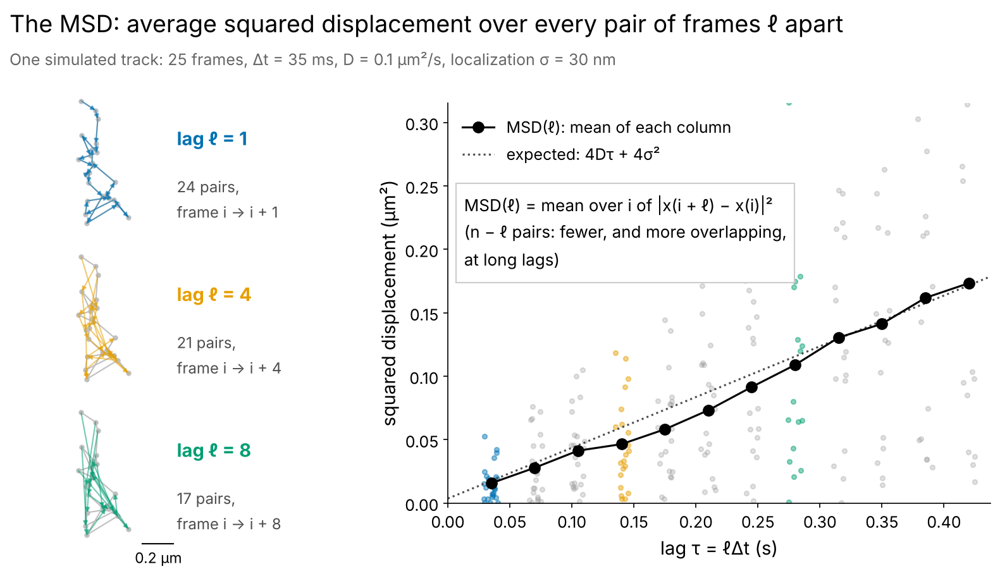
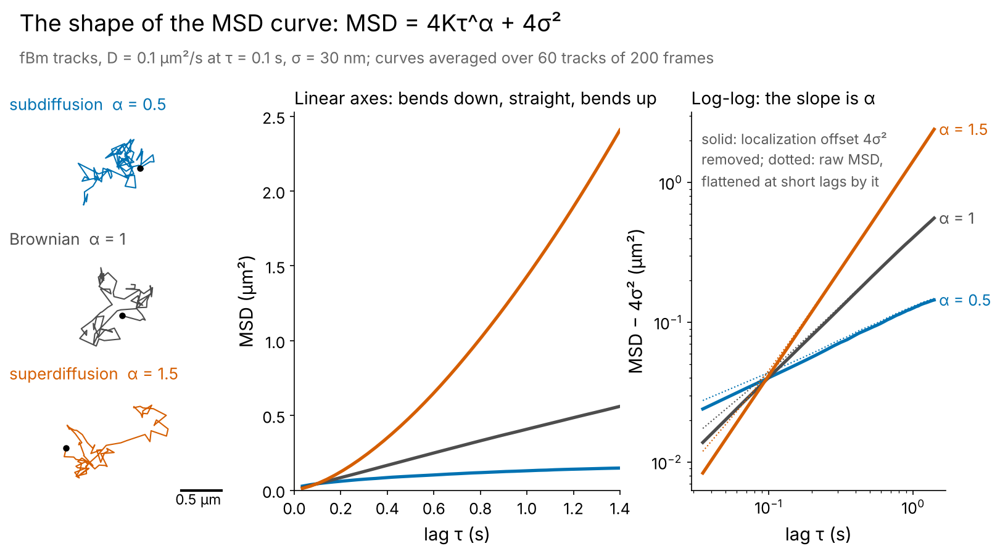
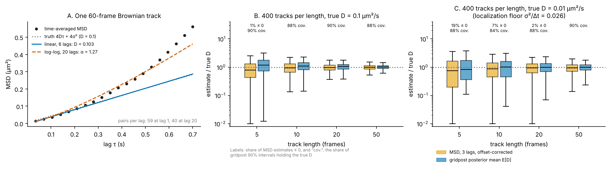

# 07 · The classic yardstick: mean-squared displacement

*diffusionkit main. Source: `diffusionkit/classic/analysis.py` (`compute_msd`, `window_lags`), `classic/estimators.py` (`fit_brownian_msd`, `fit_anomalous_msd`, `fit_linear_msd`, `fit_loglog_msd`), `classic/batch.py` (`ensemble_msd`), `classic/workflow.py` (`analyze_tracks`).*

Everyone knows the MSD. It is in the package so results can be compared with the literature, and so the likelihood methods have a familiar baseline. This explainer says exactly what it computes and where it falls short.

---

## 0. What the MSD is, in two pictures

`scripts/fig_07_msd_explained.py`; slide-sized.

*Figure 7.0a. How one track's MSD is computed. Take every pair of frames that are ℓ frames apart (left: the arrows at ℓ = 1, 4 and 8), square each displacement, and average. Each grey or coloured column on the right is one lag's squared displacements, and the black point is their mean, MSD(ℓ). For Brownian motion it should follow 4Dτ + 4σ² (dotted): 4D per unit time from the motion in two dimensions, plus 4σ² from the localization error at both ends of each displacement. A track of n frames has n − ℓ pairs at lag ℓ, and at long lags those pairs share most of their steps, so the points there are few and strongly correlated. This track was picked to be well behaved; many single tracks stray much further from the line (figure 7.1A).*

*Figure 7.0b. What the curve's shape says, for fractional Brownian motion with MSD = 4Kτ^α + 4σ² (curves averaged over 60 tracks of 200 frames, so they are smooth). Subdiffusion (α < 1) bends down, Brownian motion (α = 1) is straight, superdiffusion (α > 1) bends up. On log-log axes, once the offset 4σ² is removed, the slope is α. Left uncorrected (dotted), the offset flattens the short lags and makes α look smaller. The example tracks share one scale.*

## 1. What is computed

**Time-averaged MSD** (`compute_msd`). For one track at lag ℓ,

$$
\mathrm{MSD}(\ell) = \frac{1}{n - \ell}\sum_{i} \lVert x_{i+\ell} - x_i\rVert^2,
\qquad \text{offset}(\ell) = \frac{1}{n-\ell}\sum_i \sum_{\text{axes}}\left(s_i^2 + s_{i+\ell}^2\right).
$$

The offset is the localization contribution, computed from each frame's own reported SDs and assuming independent, zero-mean errors.

**Fits.**

- **`fit_brownian_msd`.** Ordinary least squares through the origin of MSD − offset = 4Dτ, over the first 3 lags by default (`max_lag`). A negative D is kept and flagged `nonphysical` rather than clipped, since clipping would change the estimator.
- **`fit_anomalous_msd`.** Bounded nonlinear least squares of MSD − offset = 4Kτ^α in linear space, with K ≥ 0 and 0 ≤ α ≤ 2.
- **`fit_linear_msd`.** The textbook fit with a free intercept, MSD = 4Dτ + b, where b = 4σ² is read as the localization offset.
- **`fit_loglog_msd`.** The textbook power law: OLS of log(MSD − offset) on log τ. Lags whose corrected MSD is ≤ 0 cannot be logged and are dropped, which the message counts.

**Ensemble MSD** (`ensemble_msd`). Averages the curves over tracks, weighted by pairs, with a bootstrap that resamples whole tracks (a cluster bootstrap), so the correlation within a track is respected.

**Blur.** The MSD estimators exclude tracks recorded with a nonzero exposure ("MSD estimators assume exposure 0"). Blur subtracts 4D·t_e/3 from every lag's MSD, and the classic offset does not model it. Rather than silently bias D, the code refuses.

## 2. Where it goes wrong

*Figure 7.1. A: one 60-frame Brownian track (D = 0.1 µm²/s, σ = 30 nm, no blur). The linear fit to 6 lags gets D right (0.103), but a log-log fit to 20 lags reports α = 1.27 for a purely Brownian track. B and C: 400 tracks per length, MSD D (3 lags, offset-corrected) against gridpost's E[D], at D = 0.1 and at D = 0.01 µm²/s (below the localization floor σ²/Δt = 0.026). Labels give the share of MSD estimates ≤ 0, and the coverage of gridpost's 90% intervals.*

**Long lags lie.** In panel A, the MSD at lag 20 rests on 40 overlapping displacement pairs that share most of their steps, so successive points are strongly correlated. A random upswing at long lags looks like a systematic curvature. Fitting log-log to it reads that as superdiffusion. This is the classic warning of Qian et al. (1991) and Michalet (2010). It is why α should come from a likelihood (explainer 04).

**Short tracks.** Median estimate ÷ true D, and how often the MSD estimate is ≤ 0:

| Frames | D = 0.1: MSD | D = 0.1: E[D] | D = 0.01: MSD | D = 0.01: MSD ≤ 0 | D = 0.01: E[D] |
|---|---|---|---|---|---|
| 5 | 0.79 | 1.19 | 0.76 | 19% | 0.82 |
| 10 | 0.93 | 1.10 | 0.87 | 7% | 1.01 |
| 20 | 0.97 | 1.06 | 0.94 | 2% | 0.99 |
| 50 | 0.99 | 1.01 | 0.95 | 0% | 0.99 |

- **The MSD estimator's errors are large and it has no error bar.** At 5 frames below the floor, one estimate in five is zero or negative, a value no analysis can use.
- **The posterior mean reads high at short lengths above the floor**, the 1/(n − 2) effect of the 1/D prior that explainer 03 describes. Its 90% intervals still cover 84–90% across the board, so each track says how much to trust it.
- **For a population**, the right comparison is not a histogram of either estimate but the population models of explainer 05.

## Standard or new?

| Piece | Status | Reference to check |
|---|---|---|
| Time-averaged MSD, OLS fit, offset for localization | Standard | Qian, Sheetz & Elson 1991, *Biophys. J.* 60:910; Michalet 2010, *Phys. Rev. E* 82:041914 |
| Per-frame SD offset | Standard | — |
| Refusing blurred tracks rather than ignoring blur | A deliberate choice | Berglund 2010 gives the correction if wanted |
| Ensemble MSD with a cluster bootstrap | Standard | — |
